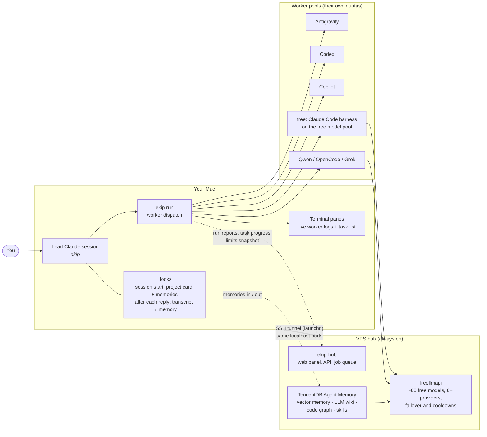
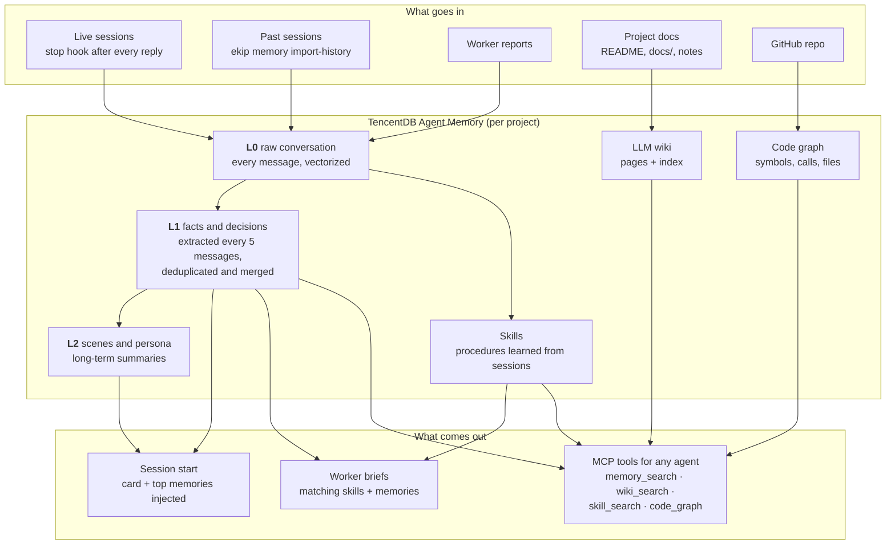
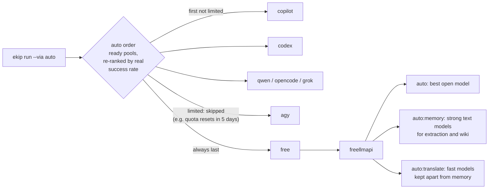
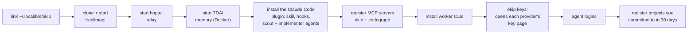

# ekip

**One terminal, one Claude, a whole team.**

You talk to a single Claude Code session, the *lead*. It spends your Claude limit only on judgment:
understanding what you want, splitting it, choosing who does what, and reviewing the result. The work
itself goes to agents that run on **other people's quotas**: Antigravity, Codex, Copilot, Qwen,
OpenCode, Grok, and about 60 free-tier models pooled behind one endpoint. A headless Claude is the last
resort, not the default.

Every project you touch gets its own **memory**: a vector database of your past sessions, an **LLM
wiki** built from its docs, a **code graph**, its own **skills** (procedures learned from how you
actually work in it) and a one-page **card**. Workers start with exactly that context instead of
re-reading the repo, so far fewer tokens go into reading.

An always-on **hub** on your VPS keeps the memory, the free model pool and a job queue running when
your Mac is closed, and serves a web panel that shows what every agent is doing right now.

```
you: "make two promo videos, fix what's left in lumareef, add feature X to the Unity game"
lead (Claude): splits it → 3 tasks → video to agy with the film skill, lumareef fix to codex with
               lumareef's memory and skills, Unity feature to copilot → reviews the diffs → reports
```

On a real two-day stretch while building ekip itself, **58% of the work ran outside Claude**: memory
extraction, wiki building, translation and two video films went to the free pool, Copilot and
Antigravity. That stretch was mostly building and debugging ekip, which only the lead can do; on normal
project work the share is higher.

---

## Contents

- [How it works](#how-it-works)
- [The memory: vectors, wiki, graph, skills](#the-memory-vectors-wiki-graph-skills)
- [Where a task goes](#where-a-task-goes)
- [Seeing what is going on](#seeing-what-is-going-on)
- [Install](#install)
- [Commands](#commands)
- [Pools](#pools)
- [Patches to upstream projects](#patches-to-upstream-projects)
- [Troubleshooting](#troubleshooting)
- [Data, privacy and terms](#data-privacy-and-terms)

---

## How it works



Four ideas carry the whole design:

1. **Claude decides, others type.** The lead plans and reviews. Everything well scoped goes to a worker
   on another quota, briefed like a capable colleague with no context: goal, files, constraints, how
   to verify, what to report.
2. **Context is prepared once, not re-read every time.** Projects are indexed ahead of time (memory,
   wiki, graph, skills, card). Workers get the relevant slice in their brief and can query the rest
   through the `ekip` MCP server.
3. **Nothing runs blind.** Every request becomes a task with steps; every worker gets its own terminal
   pane; the hub panel shows runs, tasks, pools and limits. A step that stops moving is flagged as
   stalled, whatever its label says.
4. **The always-on parts live on a server.** Memory, the free pool and the job queue keep working when
   the Mac is off. The Mac reaches them through an SSH tunnel on the same localhost ports, so local and
   remote setups look identical to every tool.

### The life of a request

```mermaid
sequenceDiagram
  autonumber
  participant U as You
  participant L as Lead (Claude)
  participant T as Task (panel)
  participant W as Worker pool
  participant M as Project memory
  participant H as Hub

  U->>L: "fix the paywall bug in sports-center"
  L->>M: project card, memories, skills (session-start hook)
  L->>T: ekip task new … --steps "Find; Fix; Test"
  T-->>H: progress (percent, current step, ETA)
  L->>W: ekip run --via auto --project sports-center "brief…"
  Note over W: brief = task + project skills + relevant memories
  W->>W: works headless in the repo, own terminal pane
  W-->>H: run started / finished, report
  W-->>M: report saved to the project's memory
  L->>L: reviews the diff, runs the tests
  L->>U: result, what was verified, what is left
  L-->>M: the conversation itself (stop hook)
```

---

## The memory: vectors, wiki, graph, skills

Memory is [TencentDB Agent Memory](https://github.com/TencentCloud/TencentDB-Agent-Memory) (TDAI),
self-hosted on the hub, with every LLM call going to the free pool. Each registered project gets its
own agent inside it, so memories never leak between projects.



| Layer | What it holds | How it is searched |
|---|---|---|
| **L0** | every user and assistant message | vector (semantic) + BM25 (keywords), merged |
| **L1** | facts, decisions, preferences, recurring fixes | vector + BM25 |
| **L2** | scene files and a persona per project | read whole |
| **Skills** | "how this project builds, releases, fixes X", with a name and description | BM25 routing, then the body |
| **Wiki** | pages written from the project's docs, with links between them | full text + graph |
| **Code graph** | symbols and call edges from the repo | `code_graph` tool, or `codegraph` locally |

**What is stored, and what is deliberately not.** The conversation is stored: your messages, the
lead's replies, worker reports, and the facts extracted from them. Tool traffic is not: file dumps,
command output and logs are most of a coding session's bytes and none of its decisions, and storing
them drowned the facts and multiplied the cost (`TDAI_IMPORT_LEAN=1` is the default). Thinking is not
stored either; the conclusion is already in the reply.

**Vectors.** All layers use one pinned embedding model, `nemotron-3-embed-1b` (2048 dimensions,
multilingual), served by NVIDIA with an OpenRouter fallback that returns identical vectors. A Turkish
question finds an English or Chinese memory about the same thing. The model never changes for an
existing index; `ekip memory reindex` backfills records that have no vector, resumably.

**Language.** Memories are written in the language you wrote in. TDAI's prompts are Chinese, and
small free models drift into Chinese because of it, so ekip patches the prompts with one strict
language rule (see [patches](#patches-to-upstream-projects)) and ships a translator for records that
were already written in the wrong language (`hub/tools/tdai-translate-l1.mjs`).

**Wiki.** Each project's Markdown is sent to TDAI's wiki builder, which extracts candidate pages with
an LLM, merges them into existing pages and indexes the result. Sources the model fails on are retried
by `ekip doctor --fix` once the wiki is ready.

---

## Where a task goes



- **Worker pools** come in a configured order and are re-ranked by their real success rate; a pool that
  failed in the last 15 minutes goes to the back; a pool whose last run hit a quota ("Resets in 140h")
  is skipped until it reopens.
- **The free pool** is [freellmapi](https://github.com/tashfeenahmed/freellmapi): one OpenAI-compatible
  endpoint over the free tiers of Google, Groq, NVIDIA, OVH, OpenRouter, Zhipu, Cerebras, Mistral,
  Cloudflare and more. It tracks every provider's rate limits and cools a model down when it hits one.
  ekip uses three routing profiles so background work never starves the rest: `auto`, `auto:memory`
  (strong instruction-following models only; weak ones broke the wiki format) and `auto:translate`.
### The free pool in numbers

| | |
|---|---|
| Models in freellmapi's catalog | **411** across **35** providers |
| Usable with the 7 keys set up here | **64** models (NVIDIA 17, Google 15, OVH 12, OpenRouter 10, Groq 7, Zhipu 3, HuggingFace 0) |
| Served in October (measured, free) | **178 million tokens**, 158,500 requests: memory extraction, wiki pages, embeddings, translation |
| Ceiling with the same keys (estimate) | **a few billion tokens a month**: NVIDIA alone allows 40 requests/min with no daily cap (~1.7M requests a month), Groq ~14,400 requests/day, Google ~1,000/day per model |
| Each extra free provider | adds its own daily allowance: Cerebras, Mistral (~50-100M/month), Cloudflare (~18-45M), Routeway and BazaarLink (DeepSeek V4), … `ekip keys` opens their pages |

The ceiling is a rate-limit ceiling, not a promise: free models are slower than paid ones, time out
under load and cool down when they hit a limit. That is why ekip routes background work to the free
pool and keeps your Claude for decisions.

- `--via a,b,c` runs the same task on several pools at once, each in its own git worktree and branch;
  you compare and merge the best.

---

## Seeing what is going on

You should never have to ask an agent "is it still working?".

| Where | What you see |
|---|---|
| **Task pane** (bottom of the lead's terminal) | every request as a task: percent, current step, ETA; a running step's detail line (rate, model, last error); **⚠ stalled** when a step has not moved for 15 minutes; two lines per task when space is short |
| **Worker panes** | one per worker, titled with its label, live tool calls, a quiet "still working · 12 min" line when it thinks, closes itself when the worker ends or is killed |
| `ekip limits` | which pool is limited and when it reopens, each free provider's open models and last-24h errors, and where a new task would go right now |
| `ekip doctor [--fix]` | tunnel, pools, every project's graphs, wiki and memory, the vector index; `--fix` repairs what is safe to repair; launchd runs it every 30 minutes |
| **Web panel** | overview (daily jobs from the VPS queue and the Mac), tasks with steps and stalls, runs (started, finished, cancelled), pools with worker quotas and routing, projects with their code map |

```
◆ ekip  görevler · 2
● Fix the paywall · sports-center  ████████░░░░ 63% · 14 dk kaldı
    2/4 bitti  ▶ Test on device · copilot · 3 dk
● Memory import · ekip  ███████████░ 92% · 20 dk kaldı
    5/6 bitti  ⚠ Import sessions 23 dk'dır ilerleme yok
```

Runs killed from outside (a closed terminal, a hard kill) report themselves as cancelled on their way
out; runs that vanished without a word are found and closed by `ekip reconcile` (also run by `doctor`
and before every new run).

---

## Install

### What you need

- macOS with `git`, `tmux`, `sqlite3` and Node.js 22 or later (freellmapi wants 22 to 24: `brew install node@24`)
- Docker (Docker Desktop or OrbStack) for a local memory stack, or a VPS for the hub
- [Claude Code](https://claude.com/claude-code), logged in
- Optional worker CLIs: Antigravity (`agy`, the strongest), Codex, Copilot CLI, Qwen Code, OpenCode, grok-cli; `ekip init` installs the ones on npm

### On your Mac

```bash
git clone https://github.com/duzgunberke/ekip.git && cd ekip
node plugin/bin/ekip.js init
```

`init` is interactive and safe to run again:



Then open a new terminal and run `ekip`. Ask for anything.

### Free model keys

```bash
ekip keys          # opens each missing provider's key page in turn; paste the key, Enter skips
ekip keys --all    # ask again for providers that already have a key (to replace it)
```

The wizard covers Groq, Google AI Studio, Cerebras, OpenRouter, NVIDIA NIM, Mistral, Cloudflare Workers
AI, Cohere, Zhipu, HuggingFace, and the free DeepSeek routes (Routeway, BazaarLink, Router9,
ModelScope). Keys go into freellmapi's declarative config and, with a hub, straight to the VPS.

### The VPS hub (recommended)

The hub runs what should never sleep. On the server:

1. Copy `hub/` to `/data/ekip/hub`, fill in `hub/.env` from `hub/.env.example`
   (`EKIP_HUB_TOKEN`, `EKIP_HUB_PASSWORD`, `FREELLMAPI_ENCRYPTION_KEY`, …) and run
   `docker compose -p ekip up -d --build`.
2. Clone TencentDB Agent Memory to `/data/ekip/tdai` and start its scripts (`deploy/global-images`)
   with the memory LLM pointed at freellmapi (`MEMORY_LLM_BASE_URL=http://freellmapi:3001/v1`,
   `MEMORY_LLM_MODEL=auto:memory`, `MEMORY_EMBEDDING_MODEL=nemotron-3-embed-1b`).
3. Put the patched files under `/data/ekip/tdai-patches/app/…`; `start-memory-core.sh` bind-mounts
   every file there over the same path in the container ([details](hub/tools/tdai-patches/README.md)).
4. Route your domain to `http://ekip-hub:7777` (with Coolify: a Traefik dynamic file, see
   [hub/README.md](hub/README.md)). Keep the TDAI and freellmapi ports closed to the internet.

On the Mac:

```bash
ekip remote <ssh-host>                          # stop local services, use the hub
ekip tunnel install                             # launchd keeps the SSH tunnel up
ekip hub link https://ai.example.com <EKIP_HUB_TOKEN>
ekip hub push                                   # projects, cards and memory ids to the hub
ekip memory import-history                      # past Claude Code sessions into each project's memory
```

---

## Commands

```bash
# daily
ekip                         # the lead session (your subscription); it dispatches by itself
ekip --free                  # the lead on free models, when your Claude limit is out
ekip status                  # pools, memory, panel, team, last runs
ekip limits                  # what is limited, where a new task would go
ekip doctor [--fix]          # check (and repair) everything
ekip tasks [--watch|--all]   # the task list the panes and panel show

# workers
ekip run [--via POOL|a,b,c] [--project NAME|--cwd DIR] [--model ID] [--plugin P] [--skill S] [--task ID --label L] "task"
ekip clean <id>              # worktrees of a multi-pool run
ekip reconcile               # close runs whose process vanished
ekip agents ls|install|login|test

# projects and memory
ekip project add|scan|ls|show|sync|card
ekip memory search|remember|ingest|import-history|reindex|up|down|status|open
ekip skill ls|search|show <project> [query|name]

# hub
ekip job "task" --project NAME [--via auto|copilot|free] | job ls | job show ID
ekip hub link|push|status|open   ·   ekip remote <host>   ·   ekip tunnel install|status
ekip vps add|token|status|sh|apps|deploy|logs|restart     # SSH + Coolify API

# setup
ekip init · ekip keys [--all|apply] · ekip key add|list · ekip up|down|logs
```

## Pools

| `--via` | what | quota |
|---|---|---|
| `agy` | Antigravity CLI | your Google account |
| `codex` | OpenAI Codex CLI | your ChatGPT plan (works on the free plan with lower limits) |
| `copilot` | GitHub Copilot CLI | Copilot free tier or plan |
| `qwen` | Qwen Code | the free pool, or your Qwen account |
| `opencode` | OpenCode | its free models, or your providers |
| `grok` | grok-cli | the free pool, or xAI with `GROK_API_KEY` |
| `gemini` | Gemini CLI | `GEMINI_API_KEY` (the personal free tier is Antigravity now) |
| `free` | Claude Code `--bare` on the free pool, through the memory proxy for registered projects | free pool |
| `claude` | headless Claude with your skills and plugins | your subscription; last resort |
| `auto` | the first ready, unlimited pool in the ranked order, then `free` | |

`--plugin` / `--skill` work with every pool: Claude workers load them, the others are told to read and
follow the skill's `SKILL.md`. Example: `--via copilot --plugin lemo-opuscar` directs a film.

Inside the lead, two Claude subagents keep its own context small: `scout` (Haiku, read-only) finds
code and facts, `implementer` (Sonnet) does a coding step that needs the session's tools.

## Shared tools

Third-party tools used by more than one project live in `/Volumes/SSD/Projects/tools` (or wherever you
point them), never inside a project: freellmapi, TencentDB Agent Memory, hoptell, earshot (sound for
code-made films, also an MCP server), ACE-Step (music), img2threejs. The paths are in
`data/config.json` (`freellmapiDir`, `tdaiDir`, `hoptellDir`).

## Patches to upstream projects

ekip clones these projects and does not fork them. Where they needed fixing, the patch is kept here
with an explanation, and applied without touching their repos:

| Where | Problem | Fix |
|---|---|---|
| TDAI memory-core, `upsertL0` | `DELETE FROM l0_fts WHERE record_id = ?` on an UNINDEXED FTS5 column scanned the whole table on every message; at 66k messages the core sat at 100%+ CPU and writes crawled | skip the delete for new records and for re-sent unchanged ones: CPU 130% → 30%, writes 3-7× faster ([patch](hub/tools/tdai-patches/memory-core-l0-fts-scan.patch)) |
| TDAI prompts (extraction, dedup, scenes, persona, skills) | small models answered in Chinese because the prompts are Chinese; dedup copied the language of old memories | one strict language rule at the end of each prompt |
| TDAI importer (`agents/asset-import.ts`) | a 1.2 GB session crashed it (V8 string limit) and skipped the whole folder; 100-message batches outran the gateway timeout; one failed batch dropped the whole session; progress was saved only per folder | streamed reading without inline images, `TDAI_IMPORT_LEAN`, 20-message batches, per-batch retry, per-session checkpoint |
| freellmapi deploy | a per-IP limit of 120 requests/min throttled every internal client against each other (they share one Docker IP) | `PROXY_RATE_LIMIT_RPM=1000`; provider limits are tracked separately |

## Troubleshooting

| Symptom | Look at | Usual cause |
|---|---|---|
| a step shows ⚠ stalled | its detail line, `ekip limits` | the free pool is saturated, or a pool hit its quota |
| a pool is skipped by `auto` | `ekip limits` | its last run hit a quota; the reopen time is shown |
| memory feels slow, imports time out | `ekip doctor`, `docker stats` on the hub | memory-core busy; is the FTS patch mounted? |
| a wiki stays "processing" | `ekip doctor` | slow free models; failed sources are retried after it is ready |
| a provider says healthy but nothing answers | `ekip limits` (shows "no models") | the key is valid but has no models or credits (HuggingFace) |
| a worker pane never closes | `ekip reconcile` | the worker was killed before it could report |

## Data, privacy and terms

- **Where things live.** Everything ekip keeps is in `data/` (git-ignored): keys, the project registry
  and cards, run logs, worktrees, task state, background job scripts. Claude Code runs the plugin from
  its cache; `~/.config/ekip/root` points it back here.
- **Where your text goes.** Memory extraction, wiki building and translation use the free pool, so
  session text and docs are sent to those providers. Don't register a project whose text must not leave
  your machines, or point `auto:memory` at a provider you trust.
- **Provider terms.** One account per provider. Extra accounts made to get around free-tier limits
  break the providers' terms, and ekip will not help you make them.
- **Hub security.** The API needs a bearer token; the panel uses a password, an HttpOnly session
  cookie and a CSRF header. TencentDB and freellmapi are never exposed publicly.

## Built on

[freellmapi](https://github.com/tashfeenahmed/freellmapi) ·
[TencentDB Agent Memory](https://github.com/TencentCloud/TencentDB-Agent-Memory) (the LLM wiki follows
[Karpathy's idea](https://gist.github.com/karpathy/442a6bf555914893e9891c11519de94f)) ·
[codegraph](https://github.com/colbymchenry/codegraph) ·
[hoptell](https://github.com/EminUZUN/hoptell) ·
[shadcn-admin](https://github.com/satnaing/shadcn-admin) for the panel ·
and the agent CLIs listed under [Pools](#pools).

## License

MIT. The cloned projects keep their own licenses.
