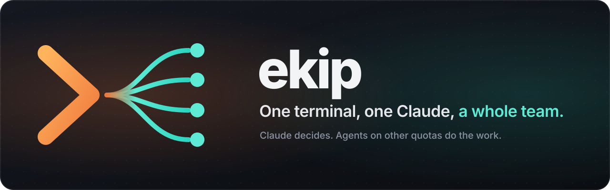
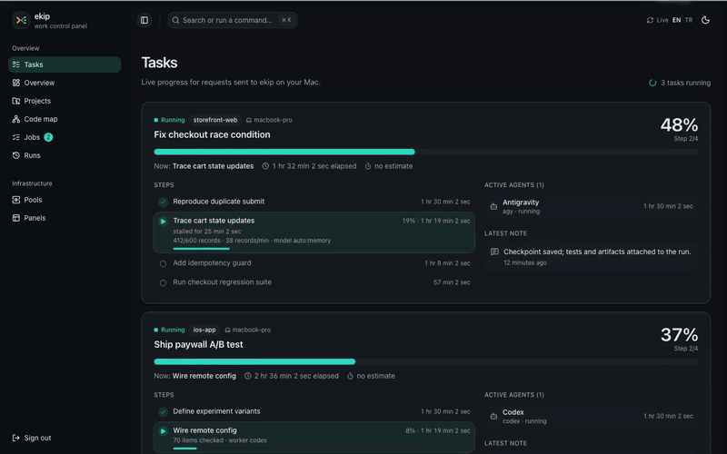
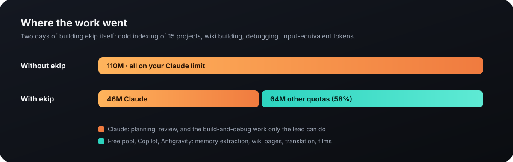
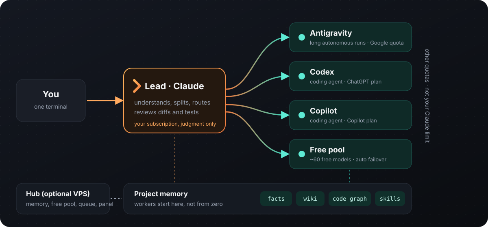
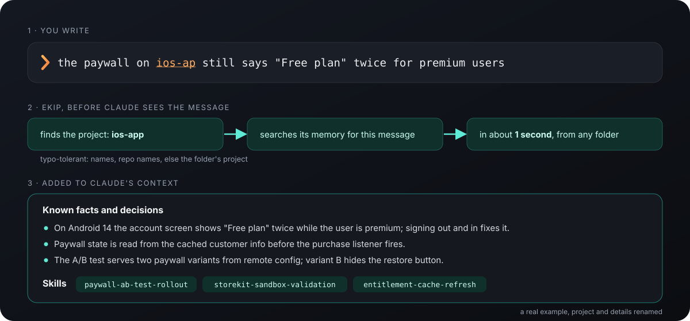
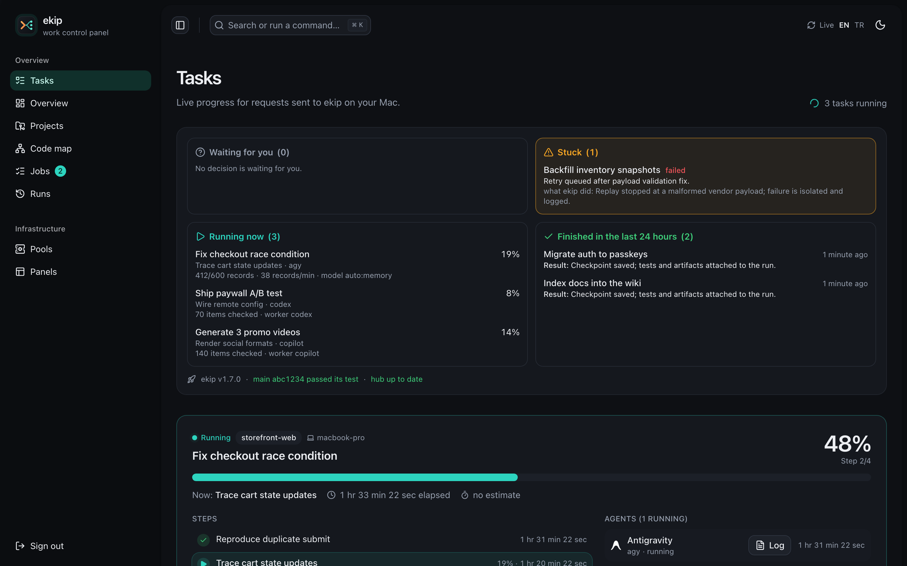
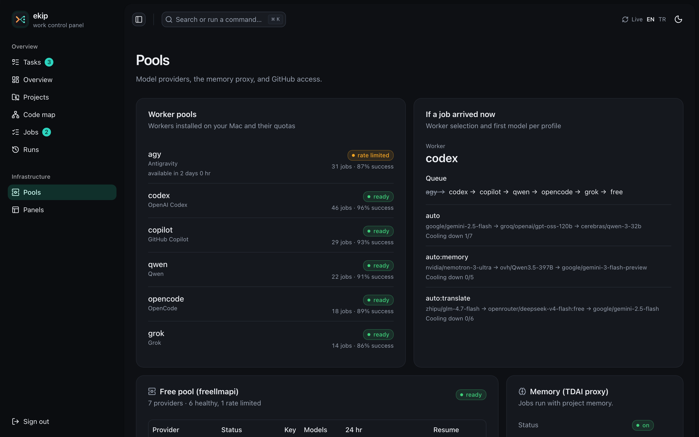
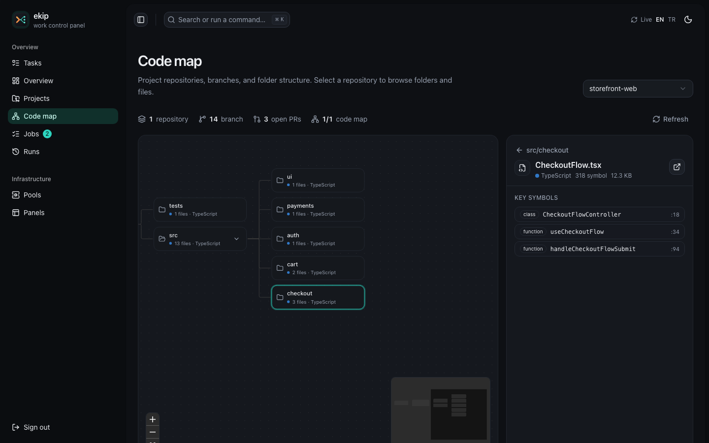
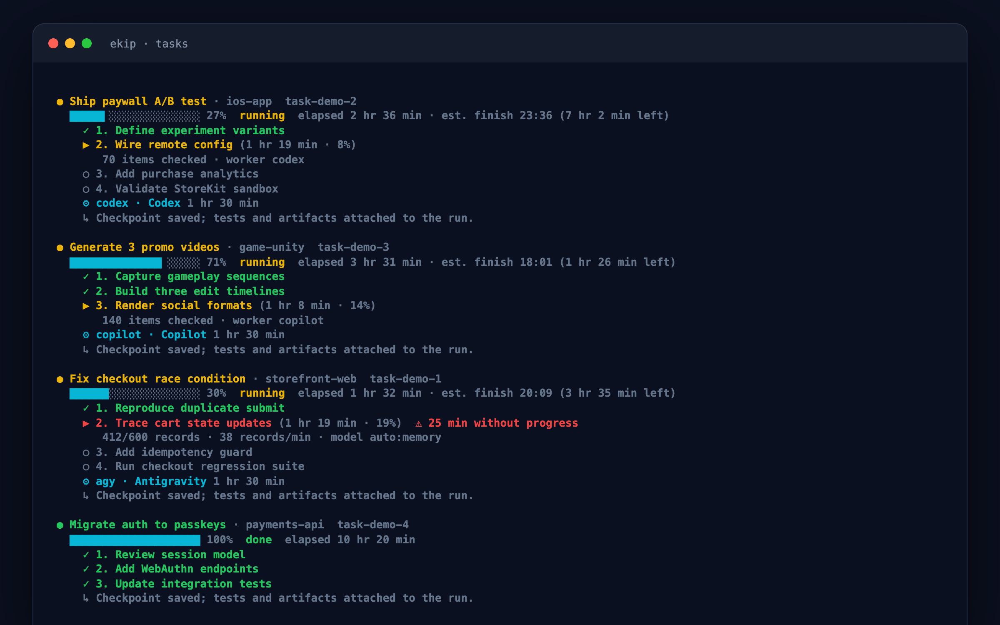
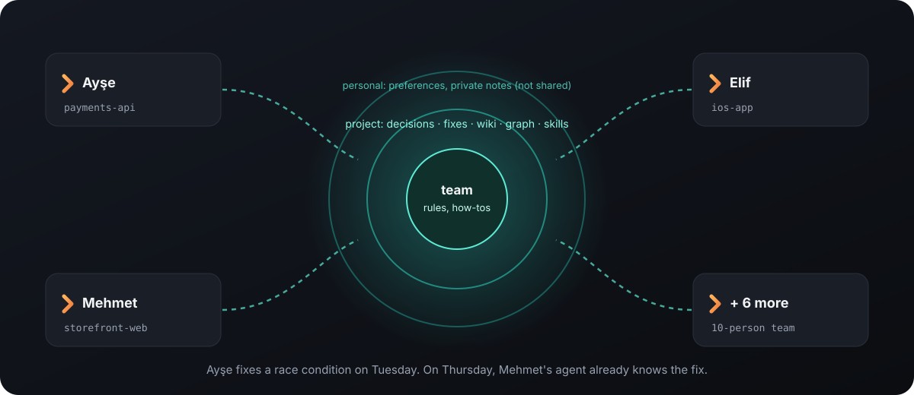

<p align="center">
  
</p>

<p align="center">
  <b>Turn one Claude Code session into a team lead.</b><br>
  Claude plans and reviews. Agents on other quotas do the work, each starting from the project's own memory.
</p>

<p align="center">
  <b>English</b> · <a href="README.tr.md">Türkçe</a>
</p>

<p align="center">
  
</p>

> [!NOTE]
> **Status:** v1.1, used every day by its author on 15 projects. macOS first; the hub runs on any Linux VPS with Docker.

## Why

Claude Code's limit goes mostly to **reading**: files, logs, history, the same context again in every
session. ekip changes who does what:

- **Claude only decides.** It understands the request, splits it, picks a worker for each part and
  reviews the result. Reading and typing go to agents on **other quotas**: Antigravity, Codex, Copilot,
  and about 60 free-tier models behind one endpoint.
- **Context is prepared once.** Every project gets a memory: past sessions in a vector database, an LLM
  wiki built from its docs, a code graph and its own skills. Workers start from that instead of
  re-reading the repo.
- **You see everything.** Each worker gets a terminal pane, each request becomes a task with live
  steps, and a web panel shows runs, quotas and which model a new task would go to. Without a server,
  `ekip init` runs the panel on your own computer at http://localhost:7777.

<p align="center"></p>

> [!TIP]
> **58% was the worst case:** two days of building ekip itself and indexing 15 projects cold, work only the lead could do. **The next day it was 81%.**
> Measure it on your own work with `ekip savings`: it reads your Claude sessions, the workers' logs and the free pool, day by day.

## How it works

<p align="center"></p>

```text
you  › make two promo videos, fix what's left in storefront-web, add passkeys to payments-api
lead › 3 tasks · videos → Antigravity + film skill · storefront fix → Codex + its memory · passkeys → Copilot
       reviews the diffs and renders, reports what shipped, what was verified, what is left
```

### Mesai modu: every pool at work at once

With several pools signed in, `ekip mesai on` turns on the work shift: the lead splits each request
into as many independent parts as the pools can take and dispatches them in parallel, racing the
uncertain ones, while its own Claude only plans and reviews. Each pool has a capacity (codex, copilot
and agy 2, qwen, opencode and grok 1, free 3; `poolConcurrency` in `data/config.json` changes it), and
`--via auto` skips pools that are full or out of quota, so parallel runs spread out by themselves.
Optional: [jcode](https://github.com/1jehuang/jcode) as one more harness on the free pool (about 60 MB
per worker instead of 600; set `jcodeBin` and a jcode provider profile pointing at freellmapi).
`ekip mesai status` shows each pool's running/capacity and success rate; `ekip mesai all "task"` runs
one task on every pool with a free slot, each on its own branch. The headless Claude pool joins only
with `--include-claude`.

## Joins projects already in flight

You don't start from zero. When ekip registers a project it imports your **past Claude Code sessions**
for it, indexes the code into a graph, builds a **wiki** from its docs and extracts **skills** (how this
project builds, releases, fixes its usual problems). The first task you give is already informed by
everything you decided before.

Repeated work can become a real project-local Claude Code skill: `ekip skill learn PROJECT` reviews
run history and saves proposed `SKILL.md` files as candidates; inspect them with `ekip skill candidates`
and explicitly install one with `ekip skill accept PROJECT NAME`. `ekip skill prune PROJECT` only
reports stale TencentDB skills and never removes local skill files.

## Memory that follows your message

Run `ekip review [--project NAME] [--base REF]` to run relevant project checks and get two read-only reviews of changed files. Use `--checks-only` for checks alone, and `ekip review profile NAME --refresh` to regenerate the project's review lenses.

Open Claude in any folder and mention a project, even with a typo. ekip finds it, searches that
project's memory for your message and adds what matters, in about a second.

<p align="center"></p>

How memory works and why vectors matter, in depth: [docs/memory.md](docs/memory.md) and the author's
2023 article [Vektörel Database nedir, ne işe yarar?](https://medium.com/@duzgunberke/vekt%C3%B6rel-database-nedir-ne-i%C5%9Fe-yarar-f832b30421ac) (in Turkish).

## See it

<p align="center"><br><sub><b>Tasks</b> · every request as live steps; a step that stops moving is flagged</sub></p>

<table>
  <tr>
    <td width="50%"><br><sub><b>Pools</b> · who is limited, and where a new task would go</sub></td>
    <td width="50%"><br><sub><b>Code map</b> · every project indexed into a graph</sub></td>
  </tr>
</table>

<p align="center"><br><sub><b>Terminal</b> · the same tasks in a pane next to your Claude session</sub></p>

## Built not to get stuck

Long agent work fails quietly: a CLI hangs, a free model stops answering, a task says "running" all
night. ekip handles that itself, so you never have to chase it.

- **Every worker has a watchdog.** 15 minutes without output or 90 minutes in total, and it is stopped;
  the reason goes onto the task and `auto` moves the work to the next pool.
- **Tasks close themselves** when their steps are done or their last worker ends, and a task nobody
  touched for 6 hours is closed as stalled. The pane and the panel never show yesterday's work as live.
- **Estimates are measured, not guessed.** The finish time comes from the real rate of progress; with
  no basis yet, ekip shows none instead of a made-up number.
- **Background jobs run one copy at a time**, so two imports never fight over the same quota.
- **Every worker starts from the project's knowledge.** `ekip run --project` searches the project's
  skills and memory with the brief and appends what matches, even when the lead forgot to look.
- **You can see whether that knowledge is used.** `ekip stats` counts memory, wiki, skill and code
  graph lookups per project, by the lead's hook, worker briefs and MCP calls, with hit rates, which
  skills workers actually opened, and run success with and without knowledge (signals, not proof).
- **Nothing runs out of sight.** Workers open in a pane, and any long job the lead starts itself
  gets one too (`ekip show <log>`).
- **A pool whose quota ran out leaves the rotation** until it resets, instead of failing every job sent
  to it; `ekip agents` shows when it comes back.
- **The panel tells the truth.** Updates that did not reach the hub are sent again, every finished
  run brings its log, a long step stays "alive" while real work is measured, and the terminal pane
  restarts itself when ekip is updated.
- **Memory stays in your language.** A nightly sweep rewrites any memory a free model wrote in the
  wrong language, text, search index and vector together.

## Reviews and skills that fit each project

Every project has its own checks and its own traps. ekip learns them instead of applying one generic
review to everything.

- **`ekip review`** looks at what changed, picks the project's own check scripts that touch those
  files (skipping anything that writes to live services), runs them, and asks two reviewers on
  different pools to read the diff through the project's review profile: the rules from its
  `CLAUDE.md`, its known gotchas and the checks behind them.
- **Lessons stay.** When a worker fails and a later attempt works, the lead saves what made the
  difference into the project's memory.
- **Repeated work becomes a skill.** When the same kind of task comes up again and again, ekip drafts
  a proper `SKILL.md` for that project from the real runs; you accept it with one command and every
  agent can use it from then on.

## Settings that travel with the project

Run `ekip project config <name>` once and the project gets a `.ekip/` folder, committed with its
code, so everyone who works on it with ekip shares the same setup:

- `rules.md`: the project's rules, added to every worker's brief and to the lead's context.
- `review.md`: the review profile `ekip review` reads changes through.
- `checks/`: the project's own check scripts; `ekip review` runs them on every change.
- `dev.json`: the development database mapping (never passwords).

Process skills stay in `.claude/skills/`, where Claude Code reads them.

## Works against your environments (optional)

Tests and migrations should never touch production. If you want ekip's workers to run against real
data stores, give them an environment that is safe to break:

- **Your own development environments.** If your company already has dev, test or UAT systems,
  connect them the way you connect any tool to Claude Code: an MCP server for the database or
  service, or connection settings in the project's environment. Workers use them; production stays
  out of reach.
- **Or let ekip host them.** `ekip dev` keeps one development Postgres and Redis on your own server,
  gives every project an isolated database, and opens a local tunnel with a ready `.env.ekip-dev`.
  It refuses anything that is not a development target. Jobs queued on the VPS hub get the same
  environment, addressed for the server.

## Agents that talk to each other

Short tasks run headless and report back. Long-lived agents can open in their own terminals as
**team members** and message each other through [hoptell](https://github.com/EminUZUN/hoptell): one
asks another to review a file, or hands over the next step. `ekip team up --open` starts them.

## Quick start

Needs macOS, Node 22+, Docker and [Claude Code](https://claude.com/claude-code).

```bash
git clone https://github.com/duzgunberke/ekip.git && cd ekip
node plugin/bin/ekip.js init     # services, plugin, MCP servers, worker CLIs, free model keys, your projects
ekip                             # start the lead; ask for anything
```

On first start ekip greets you, and every start it checks what is still missing: a newer ekip
release, a project that is not indexed, no code graph or wiki, Claude history not in memory,
memories without vectors, worker pools or free model keys not connected. Claude offers the most
useful step once, in a sentence, and does it when you say yes. New releases install themselves: when one is out and your checkout is clean, ekip fast-forwards it
and tells you once (`"autoUpdate": false` in `data/config.json` turns that off, `ekip update` does it
by hand).

`ekip keys` opens each free provider's key page in turn. To keep memory, the free pool and a job queue
running while your Mac is off, connect a VPS: [docs/install.md](docs/install.md).

What it does not do: it does not make free models as good as Claude. They are slower, time out under
load and cool down at their limits. ekip routes around that and keeps Claude for decisions.

## What is next

### v2: one shared memory for a whole team

<p align="center"></p>

Today ekip is one person, one Claude and a whole team of agents. Next: a whole team of people on **one
shared memory**.

- Everyone keeps their own terminal and their own agents, all connected to one hub.
- What one person solves in a project goes into that project's memory. The next day, a teammate's agent
  already knows the fix, the test that caught it and what did not work.
- Wikis, code graphs and skills are shared; a procedure one person teaches is used by everyone's agents.
- Personal notes stay personal. Team-wide rules live in a team layer every agent reads.
- New people start from the team's experience, and what someone knows stays when they leave.

The foundation is already here: memory is isolated per project and per agent inside one store. v2 opens
it to several people with roles and privacy rules. Watch the repo to follow along.

### v3: integrations, wired in for you

Projects need more than code: error tracking, uptime checks, analytics, metrics, logs. Many teams
already run these tools, often on the same server as their apps. v3 lets ekip find them, set them up
when they are missing, and wire them into every project.

```bash
ekip integrate my-app errors     # error tracking: self-hosted GlitchTip or a Sentry account
ekip integrate my-app uptime     # a check for every public URL of the project
ekip integrate --all errors --dry-run
```

Each integration follows the same five steps: **detect** what is already running, **provision** it
on your server only if you say yes, **connect** a project inside the tool, **wire** the SDK into the
code through a reviewed change, and **verify** that a test event arrives. Then the loop closes: new
errors and failed checks become ekip tasks with the stack trace attached, and fixes for recurring
errors become lessons and skills. See the [roadmap](docs/roadmap.md).

## Learn more

| | |
|---|---|
| [How it works](docs/architecture.md) | request lifecycle, routing between pools, what you see where |
| [Memory](docs/memory.md) | project indexing, vectors, wiki, code graph, skills, what is stored and what is not |
| [Install](docs/install.md) | Mac setup, free model keys, the VPS hub |
| [Commands and pools](docs/commands.md) | every command, every worker pool |
| [Operations](docs/operations.md) | patches to upstream projects, troubleshooting, data and privacy |
| [Roadmap](docs/roadmap.md) | v2 shared memory and teamwork, v3 integrations (error tracking, uptime, analytics, metrics) |
| [Brand](docs/brand.md) | logo, colours, usage |

## Built on

[freellmapi](https://github.com/tashfeenahmed/freellmapi) ·
[TencentDB Agent Memory](https://github.com/TencentCloud/TencentDB-Agent-Memory) ·
[codegraph](https://github.com/colbymchenry/codegraph) ·
[hoptell](https://github.com/EminUZUN/hoptell) ·
[shadcn-admin](https://github.com/satnaing/shadcn-admin) ·
and the agent CLIs of Antigravity, Codex, Copilot, Qwen Code, OpenCode and grok-cli.

MIT licensed. The projects it builds on keep their own licenses.

See [Contributing](CONTRIBUTING.md) before opening a pull request.
