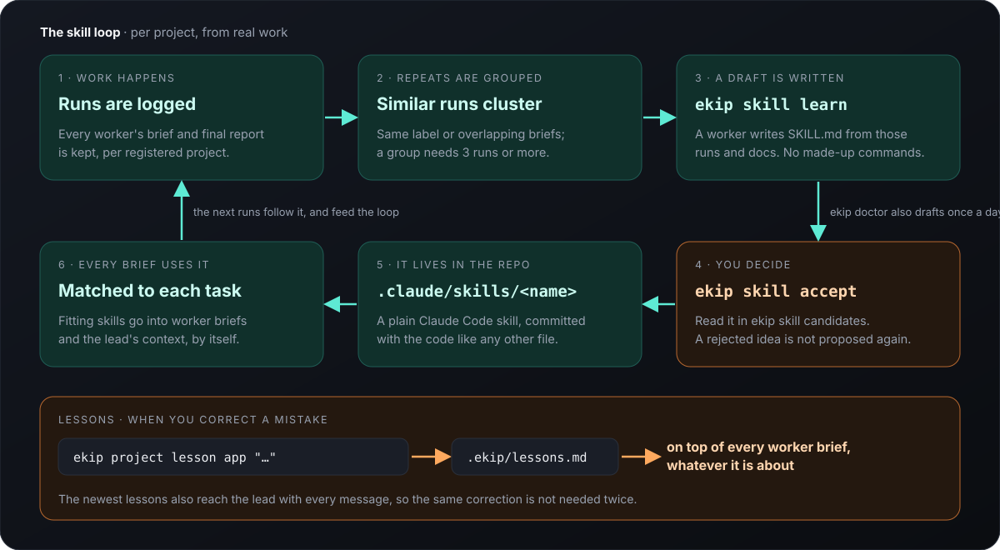

<p align="center">
  
</p>

<p align="center">
  <b>Tek bir Claude Code oturumunu ekip liderine dönüştürün.</b><br>
  Claude planlar ve inceler. Diğer kotalardaki agent'lar işi yapar; her biri projenin kendi belleği ve skill'leriyle başlar.
</p>

<p align="center">
  <a href="https://github.com/duzgunberke/ekip/releases"></a>
  <a href="LICENSE"></a>
  
  
</p>

<p align="center">
  <a href="README.md">English</a> · <b>Türkçe</b>
</p>

<p align="center">
  <br>
  <sub><code>ekip</code> yazın: solda lider, sağda worker'lar, altta canlı görevler (<a href="docs/demo/terminal-wezterm.mp4">MP4</a>)</sub>
</p>

## Hızlı başlangıç

macOS, Node 22+, Docker ve [Claude Code](https://claude.com/claude-code) gerekir.

```bash
git clone https://github.com/duzgunberke/ekip.git && cd ekip && node plugin/bin/ekip.js init
ekip kurulum   # adım adım: ücretsiz model anahtarları, worker girişleri, projeleriniz (ekip setup)
ekip           # lideri başlatın ve Claude'la konuştuğunuz gibi konuşun
```

`ekip init` servisleri, eklentiyi, MCP sunucularını, worker CLI'larını ve ekip'in kendi terminalini
(WezTerm, Dock'ta bir `ekip.app` ile) kurar. `ekip kurulum` eksik kalanları gösterir ve ertelediklerinizi
hatırlar; her açılışta en faydalı sonraki adım bir kez hatırlatılır. Dili `ekip dil tr` ya da
`ekip dil en` seçer. Yeni sürümler kendiliğinden kurulur.

## Neler sunar

<table>
  <tr>
    <td width="50%" valign="top">
      <b>Başka kotalarda bir ekip.</b> Claude isteği böler ve parçaları Antigravity, Codex, Copilot, Qwen, OpenCode, grok ve yaklaşık 60 ücretsiz modele verir. <code>ekip mesai on</code> bağlı her havuzu aynı anda çalıştırır.<br><br>
      
    </td>
    <td width="50%" valign="top">
      <b>Her şey göz önünde.</b> Her istek canlı adımları olan bir görevdir; oturumun altındaki panelde ve web panelinde görünür. Size sorulanlar kırmızıyla, takılanlar turuncuyla en üstte durur.<br><br>
      <picture>
        <source media="(prefers-color-scheme: light)" srcset="docs/screenshots/panel-tasks-light.png">
        
      </picture>
    </td>
  </tr>
  <tr>
    <td width="50%" valign="top">
      <b>"Ne oluyor?" sorusuna tek cevap.</b> <code>ekip durum</code> ne çalıştığını, sizden ne beklendiğini, neyin takıldığını ve neyin bittiğini sonuç ve bağlantılarıyla gösterir.<br><br>
      
    </td>
    <td width="50%" valign="top">
      <b>Takılmamak için tasarlandı.</b> Bekçiler, ölü worker'ları kapatan bir toplayıcı, havuz değiştirme, kuyruklar (<code>--after</code>, <code>--when</code>), <code>--resume</code> ve uzun yüklemeler ile render'lar için <code>ekip track</code>.<br><br>
      
    </td>
  </tr>
  <tr>
    <td width="50%" valign="top">
      <b>Proje başına bellek.</b> Vektör deposunda geçmiş Claude oturumları, dokümanlardan bir wiki, kod grafiği ve dersler. Bir projeden söz edin, yazım hatasıyla bile; ilgili bilgiler yaklaşık bir saniyede gelir.<br><br>
      
    </td>
    <td width="50%" valign="top">
      <b>Öğrendiği skill'ler.</b> Bir projede tekrar eden iş, sizin onayladığınız bir <code>SKILL.md</code> olur ve o projedeki sonraki her worker brief'i onu kullanır. <a href="#skill-kendi-işinizden-öğrenilen-prosedürler">Nasıl çalışır ↓</a><br><br>
      <picture>
        <source media="(prefers-color-scheme: light)" srcset="docs/assets/skill-loop-light.svg">
        
      </picture>
    </td>
  </tr>
</table>

## Skill: kendi işinizden öğrenilen prosedürler

Her projenin kimsenin yazmadığı prosedürleri vardır: nasıl yayınlandığı, alışıldık hatayı hangi
kontrolün yakaladığı, asla unutulmaması gereken o tek bayrak. ekip bunları zaten yaptığınız işte bulur
ve sıradan Claude Code skill'lerine dönüştürür.

<picture>
  <source media="(prefers-color-scheme: light)" srcset="docs/assets/skill-loop-light.svg">
  
</picture>

- **Gerçek çalıştırmalardan.** Her worker brief'i ve raporu proje başına kaydedilir. Aynı etiketli ya
  da birbirine benzeyen brief'ler gruplanır; üç ve daha fazla çalıştırmalık bir grup için prosedür,
  dosyalar, kontroller, tuzaklar ve "bitti" tanımıyla bir `SKILL.md` taslağı yazılır. Komutlar yalnızca
  çalıştırmalardan ve projenin kendi dokümanlarından alınır.
- **Siz onaylarsınız.** Taslaklar aday olarak bekler. Kabul edilen, projenin `.claude/skills/` klasörüne
  girer ve kodla birlikte commit'lenir; reddedilen bir daha önerilmez. `ekip doctor` günde bir kez
  kendiliğinden taslak çıkarır.
- **Sormadan kullanılır.** `ekip run` brief'i projenin skill'leriyle karşılaştırır ve uyanları ekler;
  liderin istem kancası da aynısını yapar. Belleğin geçmiş oturumlardan çıkardığı skill'ler de aynı
  yolla ve `skill_search`, `skill_get` araçlarıyla bulunur.
- **Dersler en üstte.** Bir hatayı düzelttiğinizde `ekip project lesson` onu yazar ve o projedeki sonraki
  her brief, konusu ne olursa olsun, onunla başlar.

Bir video düzenleme projesi "9:16 kesimi render et, ses yüksekliğini kontrol et, yükle" işini üç kez
çalıştırdı. ekip render edilecek kompozisyonu, ses kontrolünü ve bir çalıştırmayı bozan tuzağı içeren
`flow-production-unit` taslağını çıkardı. Tek bir `accept`'ten sonra bir sonraki render brief'i onu
listeledi ve worker ona göre çalıştı.

```bash
ekip skill learn my-app                    # tekrar eden çalıştırmaları grupla, SKILL.md adayları yaz
ekip skill candidates                      # yazılan taslakları oku
ekip skill accept my-app release-ios       # my-app/.claude/skills içine kur
```

Ayrıntı: [docs/skills.md](docs/skills.md) (adım adım döngü, dersler, proje incelemeleri, `.ekip/` ayarları; İngilizce).

## Nasıl çalışır?

<p align="center"></p>

Tek bir Claude oturumuyla konuşursunuz. Bir görev açar, her parçayı kotası olan ve son sonuçları en iyi
havuza yönlendirir, dönenleri `ekip review` ile inceler. Claude'un kotası karar vermeye gider; okuma ve
yazma başka yerde yürür. `ekip savings` bu payı ölçer: yazarın sıradan bir gününde işin %81'i Claude
dışında yürüdü.

<details>
<summary><b>Kısaca daha fazlası</b></summary>

- **Proje kaydı** (`ekip project add`) projenin geçmiş Claude oturumlarını içe aktarır, kod grafiği ve
  wiki oluşturur, bir proje kartı yazar. [Bellek](docs/memory.md)
- **Havuz seçimi** test edilmiş havuzlara, son başarıya ve algılanan kota sınırlarına bakar; ücretsiz
  havuz en sondadır. [Nasıl çalışır](docs/architecture.md)
- **Takılan iş** bulunur ve ele alınır: sessiz worker'lar durdurulur, ölüler nedeniyle kapatılır, uzun
  işler gerçek yüzde ve bitiş zamanıyla izlenir. [Güvenilirlik](docs/reliability.md)
- **Agent'lar** hoptell üzerinden birbiriyle konuşabilir ve güvenli geliştirme veritabanlarında
  (`ekip dev`) çalışabilir. [Nasıl çalışır](docs/architecture.md#agents-that-talk-to-each-other)
- **Bir VPS hub**, Mac kapalıyken belleği, ücretsiz havuzu ve iş kuyruğunu çalışır tutar ve web panelini
  sunar. [Kurulum](docs/install.md#optional-vps-hub)

</details>

Yapmadığı şey: ücretsiz modelleri Claude kadar iyi yapmaz. Daha yavaştırlar, yük altında zaman aşımına
düşerler ve sınırlarında soğumaya girerler. ekip bunların etrafından dolaşır ve Claude'u kararlara
saklar.

## Daha fazla bilgi

Belgeler İngilizcedir.

| | |
|---|---|
| [Nasıl çalışır](docs/architecture.md) | isteğin yaşam döngüsü, havuz seçimi, mesai modu, neyi nerede görürsünüz |
| [Bellek](docs/memory.md) | proje indeksleme, vektörler, wiki, kod grafiği, neyin saklandığı |
| [Skill'ler](docs/skills.md) | öğrenme döngüsü, dersler, proje incelemeleri, `.ekip/` ayarları |
| [Güvenilirlik](docs/reliability.md) | bekçiler, kuyruklar, izlenen işler, görev durumları |
| [Kurulum](docs/install.md) | Mac kurulumu, adım adım kurulum, terminal, sağlayıcı anahtarları, VPS hub |
| [Komutlar](docs/commands.md) | tüm komutlar, tüm worker havuzları |
| [İşletim](docs/operations.md) | upstream yamaları, sorun giderme, veri ve gizlilik |
| [Yol haritası](docs/roadmap.md) | v2 paylaşılan ekip belleği, v3 entegrasyonlar (hata, erişilebilirlik, analitik) |

## Üzerine kurulduğu projeler

[freellmapi](https://github.com/tashfeenahmed/freellmapi) ·
[TencentDB Agent Memory](https://github.com/TencentCloud/TencentDB-Agent-Memory) ·
[codegraph](https://github.com/colbymchenry/codegraph) ·
[hoptell](https://github.com/EminUZUN/hoptell) ·
[shadcn-admin](https://github.com/satnaing/shadcn-admin) ·
[WezTerm](https://wezterm.org) ·
ve Antigravity, Codex, Copilot, Qwen Code, OpenCode ile grok-cli'nin agent CLI'ları.

MIT lisanslıdır; üzerine kurulduğu projeler kendi lisanslarını korur. Pull request açmadan önce
[Katkı rehberine](CONTRIBUTING.md) bakın.
