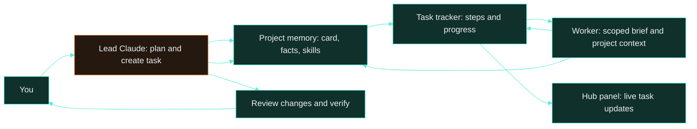
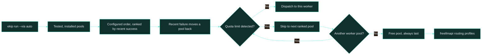

<h1> How ekip works</h1>

Follow a request from Claude's plan through worker routing, live progress, and review.

[README](../README.md) · **How it works** · [Memory](memory.md) · [Install](install.md) · [Commands](commands.md) · [Operations](operations.md)

## Request lifecycle

Claude is the lead: it understands the request, creates a task with steps, dispatches scoped work to other pools, then reviews the result. Workers receive the project card, relevant memories, and skills, plus the project's lessons file in full (`.ekip/lessons.md`, mistakes the user corrected); their reports return to the lead and project memory.

## Pool selection

`--via auto` considers installed, visible worker CLIs that passed `ekip agents test`. It starts with the configured order, ranks recent outcomes by success rate, and moves a pool that failed in the last 15 minutes to the back. A pool with a detected quota limit is skipped; the free pool is always last.

`ekip limits` shows pool readiness, recent success rates, cooldowns, quota reset times, free-provider model availability, and the route a new task would take. The `auto:memory` and `auto:translate` freellmapi profiles keep memory and translation work on their own routes.

## Seeing what is going on

| Surface | What it shows |
|---|---|
| Terminal task pane | Task progress, current step, elapsed time, ETA, and a detail line. A step with no progress for 15 minutes shows the elapsed stall time. When the pane is short, each task switches to a two-line compact view. The web panel labels this state `stalled for N min`. |
| Worker panes | A title using the worker label or project, live output, and a quiet line confirming the worker is still working. A killed worker is detected; its pane shows that it stopped and closes after 90 seconds. Completed panes also close after 90 seconds; Enter closes either immediately. |
| `ekip limits` | Worker and free-provider limits, open models, recent errors, and current routing. |
| `ekip doctor [--fix]` | Checks the tunnel, pools, project graphs, wiki, and memory; `--fix` starts safe repairs. Launchd runs the check every 30 minutes. |
| Watchdog | Every worker is stopped after 15 minutes without output or 90 minutes in total (`EKIP_IDLE_MIN`, `EKIP_TIMEOUT_MIN`); CPU use anywhere in the worker's process tree counts as activity. The reason is noted on the task and `auto` falls through to the next pool; after a silent pool the weak pools are skipped and a second silent pool in a row blocks the task. Stopping a worker leaves jobs registered with `ekip show --pid` alive. Tasks close themselves when all steps are done or the last worker ends, and are closed as stalled after 6 hours without activity (72 hours while blocked or waiting for the user). The ETA uses the measured rate since the first update and is hidden while there is no basis or the task is held. |
| Reaper | Every task command, the pane's repaint and the hub sync close workers whose `ekip run` process is gone, with the exit line and ekip's note from their log. `ekip task cancel/done` stops the task's live workers. A running step with no live worker shows as paused. |
| Machine slots | Heavy runs (`--heavy`, or a brief about a render or encode) take a slot in `data/slots/` first: as many as the cores and memory allow (`maxLocalWorkers`), none while the load is above 3x the cores. Waiting runs show "queued (place n)" on the task. A worker killed by a signal gets the likely cause in its log and task note. |
| Conditions | `ekip run --after ID` / `--when "CMD"` wait in a background process (`data/queued/`) and the task step shows `blocked` until the condition holds. |
| `ekip reconcile` | Closes runs whose processes disappeared without reporting. It also runs before a new worker run and as part of `doctor`. |
| Web panel | Overview, projects and code maps, jobs, runs, worker pools, panels, and live tasks with step details and stall status; blocked, waiting-for-you and paused tasks have their own label and no estimate. The interface supports English and Turkish; route paths remain English. |

Panel routes: `/tasks`, `/overview`, `/projects`, `/code-map`, `/jobs`, `/runs`, `/pools`, and `/panels`.

## Reliability and safety

The hub and local CLI resend task state, run state, and worker logs so a transient connection failure does not leave the panel permanently stale. Long-running task steps can send a liveness signal (`ekip task step ... --alive`); the watchdog detects silent or overlong workers, reports the reason, and lets `auto` try another eligible pool. The terminal task pane restarts itself if its process exits, while tasks close when their work ends or becomes stale. Nested worker runs have a depth and child-count cap to prevent runaway delegation.

Secrets are redacted from context and logs. Development database commands reject production targets, and destructive development resets require `--yes`. Review check commands also pass through a safety filter. See [Operations](operations.md#data-privacy-and-terms) for data flow and provider considerations.

<table>
  <tr>
    <td width="50%"> Live tasks and step status</td>
    <td width="50%"> Task progress beside the lead session</td>
  </tr>
  <tr>
    <td width="50%"> Overview across the hub</td>
    <td width="50%"> Run history and reports</td>
  </tr>
  <tr>
    <td width="50%"> Worker pools and routing</td>
    <td width="50%"> Current limits from the terminal</td>
  </tr>
</table>

---

[← Back to README](../README.md) · Next: [Memory](memory.md)
