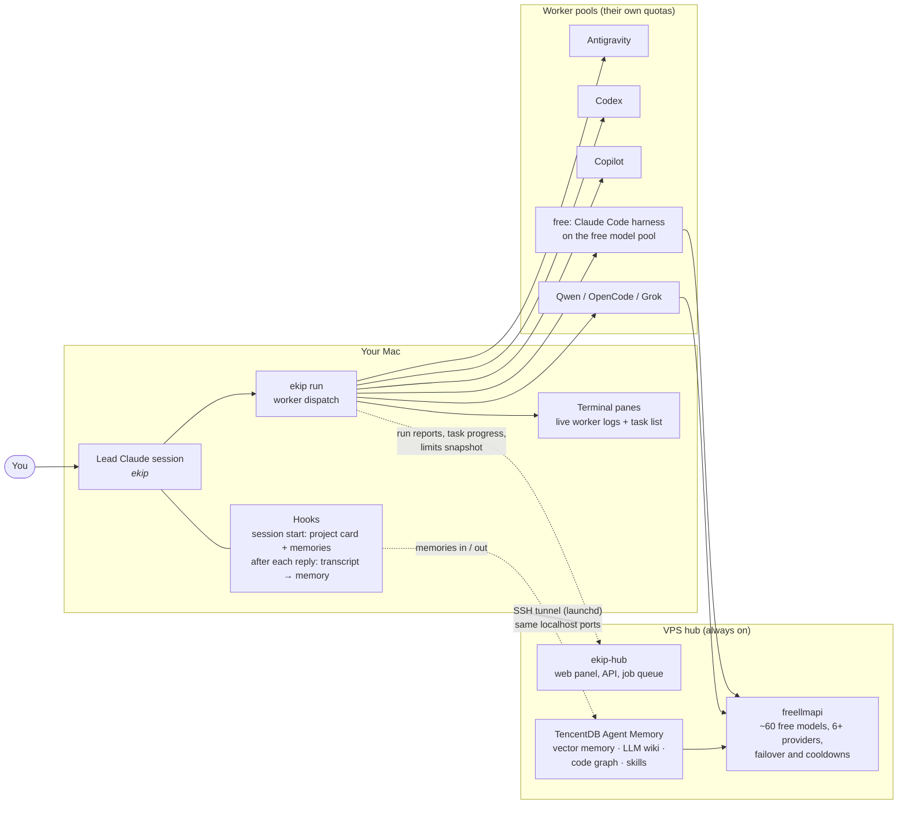
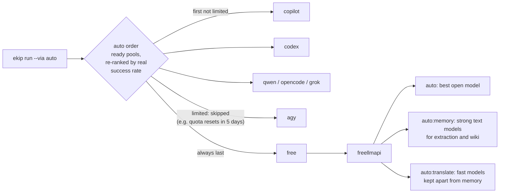

# How ekip works


The full picture: the request lifecycle, routing between pools, and how you see what is going on.


[← back to the README](../README.md)


## How it works



Four ideas carry the whole design:

1. **Claude decides, others type.** The lead plans and reviews. Everything well scoped goes to a worker
   on another quota, briefed like a capable colleague with no context: goal, files, constraints, how
   to verify, what to report.
2. **Context is prepared once, not re-read every time.** Projects are indexed ahead of time (memory,
   wiki, graph, skills, card). Workers get the relevant slice in their brief and can query the rest
   through the `ekip` MCP server.
3. **Nothing runs blind.** Every request becomes a task with steps; every worker gets its own terminal
   pane; the hub panel shows runs, tasks, pools and limits. A step that stops moving is flagged as
   stalled, whatever its label says.
4. **The always-on parts live on a server.** Memory, the free pool and the job queue keep working when
   the Mac is off. The Mac reaches them through an SSH tunnel on the same localhost ports, so local and
   remote setups look identical to every tool.

### The life of a request

```mermaid
sequenceDiagram
  autonumber
  participant U as You
  participant L as Lead (Claude)
  participant T as Task (panel)
  participant W as Worker pool
  participant M as Project memory
  participant H as Hub

  U->>L: "fix the paywall bug in sports-center"
  L->>M: project card, memories, skills (session-start hook)
  L->>T: ekip task new … --steps "Find; Fix; Test"
  T-->>H: progress (percent, current step, ETA)
  L->>W: ekip run --via auto --project sports-center "brief…"
  Note over W: brief = task + project skills + relevant memories
  W->>W: works headless in the repo, own terminal pane
  W-->>H: run started / finished, report
  W-->>M: report saved to the project's memory
  L->>L: reviews the diff, runs the tests
  L->>U: result, what was verified, what is left
  L-->>M: the conversation itself (stop hook)
```

---

## Where a task goes



- **Worker pools** come in a configured order and are re-ranked by their real success rate; a pool that
  failed in the last 15 minutes goes to the back; a pool whose last run hit a quota ("Resets in 140h")
  is skipped until it reopens.
- **The free pool** is [freellmapi](https://github.com/tashfeenahmed/freellmapi): one OpenAI-compatible
  endpoint over the free tiers of Google, Groq, NVIDIA, OVH, OpenRouter, Zhipu, Cerebras, Mistral,
  Cloudflare and more. It tracks every provider's rate limits and cools a model down when it hits one.
  ekip uses three routing profiles so background work never starves the rest: `auto`, `auto:memory`
  (strong instruction-following models only; weak ones broke the wiki format) and `auto:translate`.
### The free pool in numbers

| | |
|---|---|
| Models in freellmapi's catalog | **411** across **35** providers |
| Usable with the 7 keys set up here | **64** models (NVIDIA 17, Google 15, OVH 12, OpenRouter 10, Groq 7, Zhipu 3, HuggingFace 0) |
| Served in October (measured, free) | **178 million tokens**, 158,500 requests: memory extraction, wiki pages, embeddings, translation |
| Ceiling with the same keys (estimate) | **a few billion tokens a month**: NVIDIA alone allows 40 requests/min with no daily cap (~1.7M requests a month), Groq ~14,400 requests/day, Google ~1,000/day per model |
| Each extra free provider | adds its own daily allowance: Cerebras, Mistral (~50-100M/month), Cloudflare (~18-45M), Routeway and BazaarLink (DeepSeek V4), … `ekip keys` opens their pages |

The ceiling is a rate-limit ceiling, not a promise: free models are slower than paid ones, time out
under load and cool down when they hit a limit. That is why ekip routes background work to the free
pool and keeps your Claude for decisions.

### Everything ekip draws on (not only the free pool)

| Source | What it gives | Cost to you |
|---|---|---|
| **Antigravity** (`agy`) | the strongest worker; long autonomous coding and film runs | your Google account's quota |
| **Codex** | OpenAI's coding agent | your ChatGPT plan, the free plan included (lower limits) |
| **Copilot CLI** | GitHub's coding agent; auto-picks a strong model per run | Copilot free tier or plan |
| **Qwen Code, OpenCode, grok-cli** | more coding harnesses; on the free pool, or on their own accounts | free |
| **freellmapi** | ~60 models from Google, NVIDIA, Groq, OVH, OpenRouter, Zhipu (and any provider you add) behind one endpoint | free tiers |
| **Free DeepSeek routes** | DeepSeek V4 Flash/Pro via Routeway, BazaarLink, Router9, ModelScope | free (add their keys with `ekip keys`) |
| **NVIDIA embeddings** | the vector index (`nemotron-3-embed-1b`), with an identical OpenRouter fallback | free |
| **Headless Claude** (`--via claude`) | your skills and plugins, for what nothing else can do | your Claude subscription: last resort |
| **The lead** | planning, review, decisions | your Claude subscription |

- `--via a,b,c` runs the same task on several pools at once, each in its own git worktree and branch;
  you compare and merge the best.

---

## Seeing what is going on

You should never have to ask an agent "is it still working?".

| Where | What you see |
|---|---|
| **Task pane** (bottom of the lead's terminal) | every request as a task: percent, current step, ETA; a running step's detail line (rate, model, last error); **⚠ stalled** when a step has not moved for 15 minutes; two lines per task when space is short |
| **Worker panes** | one per worker, titled with its label, live tool calls, a quiet "still working · 12 min" line when it thinks, closes itself when the worker ends or is killed |
| `ekip limits` | which pool is limited and when it reopens, each free provider's open models and last-24h errors, and where a new task would go right now |
| `ekip doctor [--fix]` | tunnel, pools, every project's graphs, wiki and memory, the vector index; `--fix` repairs what is safe to repair; launchd runs it every 30 minutes |
| **Web panel** | overview (daily jobs from the VPS queue and the Mac), tasks with steps and stalls, runs (started, finished, cancelled), pools with worker quotas and routing, projects with their code map |

```
◆ ekip  görevler · 2
● Fix the paywall · sports-center  ████████░░░░ 63% · 14 dk kaldı
    2/4 bitti  ▶ Test on device · copilot · 3 dk
● Memory import · ekip  ███████████░ 92% · 20 dk kaldı
    5/6 bitti  ⚠ Import sessions 23 dk'dır ilerleme yok
```

Runs killed from outside (a closed terminal, a hard kill) report themselves as cancelled on their way
out; runs that vanished without a word are found and closed by `ekip reconcile` (also run by `doctor`
and before every new run).

---
