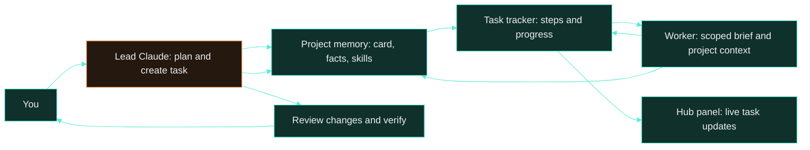
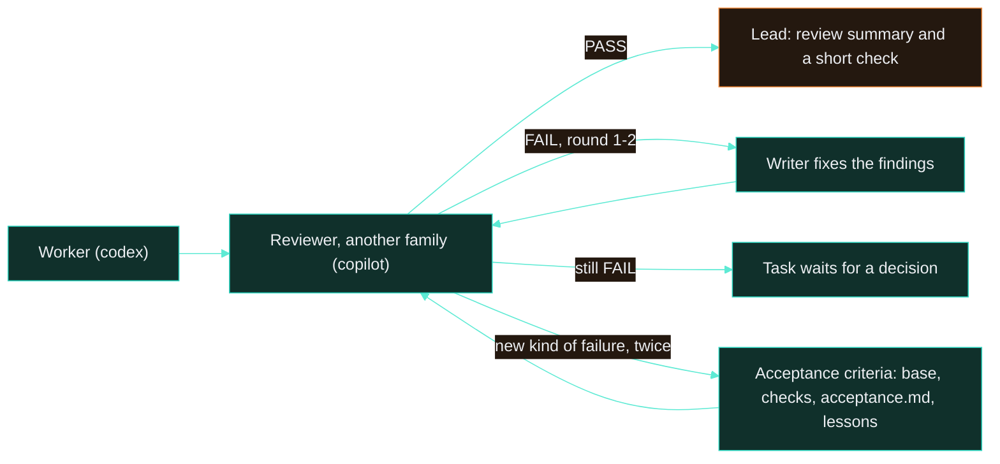
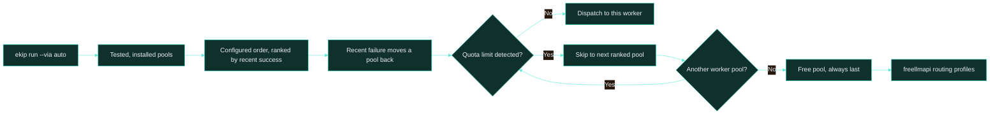
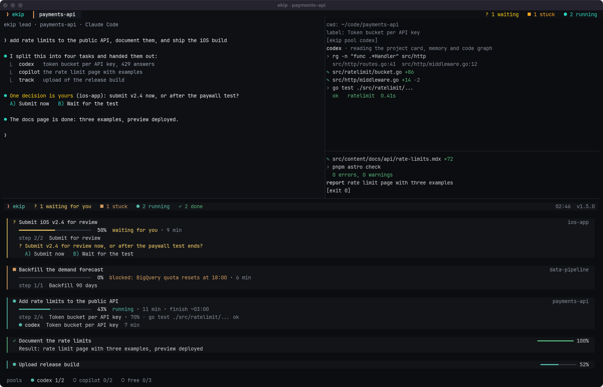
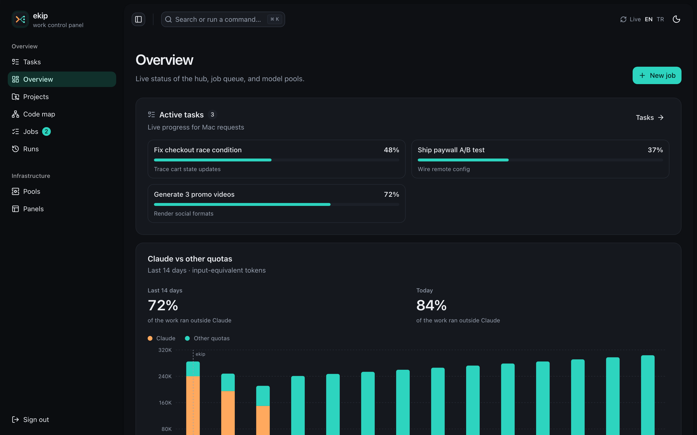
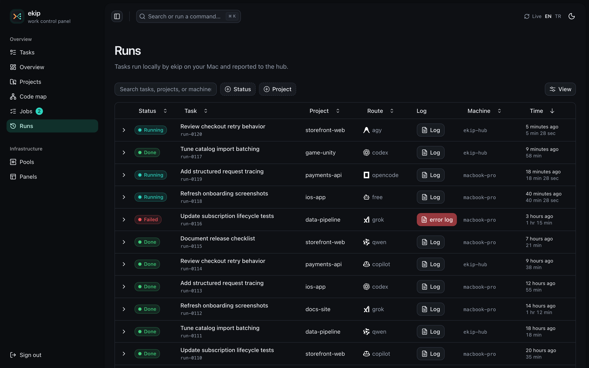

<h1> How ekip works</h1>

Follow a request from Claude's plan through worker routing, live progress, and review.

[README](../README.md) · **How it works** · [Memory](memory.md) · [Skills](skills.md) · [Reliability](reliability.md) · [Install](install.md) · [Commands](commands.md) · [Operations](operations.md)


## Why

Claude Code's limit goes mostly to **reading**: files, logs, history, the same context again in every
session. ekip changes who does what. Claude only decides: it understands the request, splits it, picks
a worker for each part and reviews the result. Reading and typing go to agents on other quotas. Context
is prepared once per project (memory, wiki, code graph, skills), so workers start from it instead of
re-reading the repo.


58% was the worst case: two days of building ekip itself and indexing 15 projects cold, work only the
lead could do. The next day it was 81%. Measure it on your own work with `ekip savings`: it reads your
Claude sessions, the workers' logs and the free pool, day by day.

```text
you  › make two promo videos, fix what's left in storefront-web, add passkeys to payments-api
lead › 3 tasks · videos → Antigravity + film skill · storefront fix → Codex + its memory · passkeys → Copilot
       reviews the diffs and renders, reports what shipped, what was verified, what is left
```

## Request lifecycle

Claude is the lead: it understands the request, creates a task with steps, dispatches scoped work to other pools, then reviews the result. With automatic review on (mesai mode, `ekip run --review`), a result first goes through an independent review on another model family, with fix rounds, before it reaches the lead (below). Workers receive the project card, relevant memories, and skills, plus the project's lessons file in full (`.ekip/lessons.md`, mistakes the user corrected); the lead gets the newest of them, and its own (`genel`), with every message through the prompt hook. Their reports return to the lead and project memory.



### Automatic review: results checked before anyone sees them

The user should be able to hand work over and leave. So in mesai mode (and with `ekip run --review`)
`ekip run` does not end when the worker ends:



The reviewer runs on a pool of another model family than the writer (`family`, `reviewerPool` in
`plugin/lib/workers/agents.js`), so it does not share the writer's blind spots. It is read-only, runs
the checks itself and answers in a fixed block (verdict, criteria met, findings with file:line and
criterion, proposals for new criteria) that `plugin/lib/review/auto.js` parses. The criteria
(`plugin/lib/review/criteria.js`) are written down and cumulative: ekip's base list, the project's
check commands, its `acceptance.md`, and its lessons, so every correction the user made is also
something each later delivery is checked against. A kind of failure the list did not cover becomes a
candidate; seen a second time, it is a new criterion. Reviewer and fix rounds are ordinary
`ekip run` processes under the same watchdog, slots and pool fallback; the task stays open while the
review runs and shows its state everywhere tasks are shown. The lead starts every run in the
background, so the run's exit (after the review) wakes it; verdicts it has not acted on also come
with its next prompt.

## Pool selection

`--via auto` considers installed, visible worker CLIs that passed `ekip agents test`. It starts with the configured order, ranks recent outcomes by success rate, and moves a pool that failed in the last 15 minutes to the back. A pool with a detected quota limit is skipped; the free pool is always last.



`ekip limits` shows pool readiness, recent success rates, cooldowns, quota reset times, free-provider model availability, and the route a new task would take. The `auto:memory` and `auto:translate` freellmapi profiles keep memory and translation work on their own routes.

### Mesai mode: every pool at work at once

With several pools signed in, `ekip mesai on` turns on the work shift: the lead splits each request
into as many independent parts as the pools can take and dispatches them in parallel, racing the
uncertain ones, while its own Claude only plans and reviews. Each pool has a capacity (codex, copilot
and agy 2, qwen, opencode and grok 1, free 3; `poolConcurrency` in `data/config.json` changes it), and
`--via auto` skips pools that are full or out of quota, so parallel runs spread out by themselves.
`ekip mesai status` shows each pool's running/capacity and success rate; `ekip mesai all "task"` runs
one task on every pool with a free slot, each on its own branch. The headless Claude pool joins only
with `--include-claude`. Optional: [jcode](https://github.com/1jehuang/jcode) as one more harness on
the free pool (about 60 MB per worker instead of 600; set `jcodeBin` and a jcode provider profile
pointing at freellmapi).

## Seeing what is going on


| Surface | What it shows |
|---|---|
| Terminal task pane | On top, the `ekip status` digest in short: counts of what waits for you, is stuck, runs and finished, the first question with its options, the first stuck job and the last release line. Then task progress, current step, elapsed time, ETA, and a detail line. A step with no progress for 15 minutes shows the elapsed stall time. When the pane is short, each task switches to a two-line compact view. The web panel labels this state `stalled for N min`. |
| Worker panes | A title using the worker label or project, live output, and a quiet line confirming the worker is still working. A killed worker is detected; its pane shows that it stopped and closes after 90 seconds. Completed panes also close after 90 seconds; Enter closes either immediately. |
| `ekip limits` | Worker and free-provider limits, open models, recent errors, and current routing. |
| `ekip doctor [--fix]` | Checks the tunnel, pools, project graphs, wiki, and memory; `--fix` starts safe repairs. Launchd runs the check every 30 minutes. |
| Watchdog | Every worker is stopped after 15 minutes without output or 90 minutes in total (`EKIP_IDLE_MIN`, `EKIP_TIMEOUT_MIN`); CPU use anywhere in the worker's process tree counts as activity. The reason is noted on the task and `auto` falls through to the next pool; after a silent pool the weak pools are skipped and a second silent pool in a row blocks the task. Stopping a worker leaves jobs registered with `ekip show --pid` alive. Tasks close themselves when all steps are done or the last worker ends, and are closed as stalled after 6 hours without activity (72 hours while blocked or waiting for the user). The ETA uses the measured rate since the first update and is hidden while there is no basis or the task is held. |
| Reaper | Every task command, the pane's repaint and the hub sync close workers whose `ekip run` process is gone, with the exit line and ekip's note from their log. `ekip task cancel/done` stops the task's live workers. A running step with no live worker or tracked job shows as paused (after 5 minutes, or 10 when the task never had a worker), gets one "orphaned" note, and the UserPromptSubmit hook puts it on top of the lead's next prompt as a mandatory action. |
| Tracked jobs | `ekip track` (`plugin/lib/workers/track.js`) starts a detached monitor per shell command; the monitor is linked to the task as a worker (`via: track`), so the reaper and the orphan check see it as live work. It writes the command's output to `data/runs/`, its state to `data/tracks/`, and every 30 seconds the step's percent, speed and finish (`rate`, `etaAt`; the task's estimate uses `etaAt` when that step is the last work left). No progress for `--stall` minutes blocks the step; `--eta-max` is checked against the speed of the first two minutes. The step is closed done or failed when the command exits. |
| Results and questions | A task keeps `result {text, links, at, auto}` and `ask {question, options, at}` next to its steps (`plugin/lib/tasks/tasks.js`). `ekip task done/result` writes the result; when `ekip run --task` ends well the first meaningful paragraph of the report and up to three paths or URLs from it are written as an `auto` result, which never replaces one the lead wrote. `ekip task ask` holds the step as `waiting-user` with the question and options; `ekip task answer` records the choice in `answers[]` and releases it. Both go to the hub with the task. |
| Status digest | `ekip status` (`plugin/lib/tasks/digest.js`) reads the task file, the tracked jobs in `data/tracks/` and the run logs and sorts everything into running, waiting for the user, stuck and finished (24 hours); it asks the hub's `GET /api/release` (`hub/src/release.js`: `last-sha`, `result.json` and the bare mirror the CI poller keeps in `EKIP_CI_DIR`, plus the hub's own commit from `EKIP_HUB_COMMIT`/`SOURCE_COMMIT`) for main's test state and keeps the answer in `data/release-status.json` for the task pane. The panel's task page draws the same digest from `/api/tasks` and `/api/release`. |
| Machine slots | Heavy runs (`--heavy`, or a brief about a render or encode) take a slot in `data/slots/` first: as many as the cores and memory allow (`maxLocalWorkers`), none while the load is above 3x the cores. Waiting runs show "queued (place n)" on the task. A worker killed by a signal gets the likely cause in its log and task note. |
| Conditions | `ekip run --after ID` / `--when "CMD"` wait in a background process (`data/queued/`) and the task step shows `blocked` until the condition holds. |
| `ekip reconcile` | Closes runs whose processes disappeared without reporting. It also runs before a new worker run and as part of `doctor`. |
| Web panel | Overview, projects and code maps, jobs, runs, worker pools, panels, and live tasks with step details and stall status; blocked, waiting-for-you and paused tasks have their own label and no estimate. Above the task list a digest card shows what waits for you (red, with the options), what is stuck (orange, with what ekip did), what runs, what finished in 24 hours with its result and links, and the release line. The interface supports English and Turkish; route paths remain English. |

### Terminal back ends

Panes go through `plugin/lib/core/terminal.js`, one small interface per terminal: `detect()` (from `WEZTERM_PANE`, `KITTY_WINDOW_ID`, `TERM_PROGRAM`/`ITERM_SESSION_ID`), `listPanes()`, `openPane(command, { below, title })`, `paneAlive(id)`, `focus(id)`, `setTitle(id, title)`. The old names in `core.js` forward to it.

| Back end | How | Task pane stays single by |
|---|---|---|
| iTerm2 | AppleScript (`osascript`); worker panes in a column right of the lead, past five as tabs | a flag file with the session id, checked against the open sessions; an osascript timeout counts as "still open" |
| WezTerm | `wezterm cli --no-auto-start` `list --format json`, `split-pane`, `spawn`, `set-tab-title`, `activate-pane` | its title (`ekip · görevler`, set by the pane's shell) and an `ekip_role` user variable in the lead's tab of the pane list; a failed list opens nothing |
| kitty | `kitty @ ls`, `launch`, `focus-window`, `set-tab-title` (needs `allow_remote_control` and the splits layout) | its title in `kitty @ ls` |
| other | a new Terminal.app window | no task pane |

Each lead records its own id on its tasks (`terminal.js` `leadId()`: the iTerm2 session, `wezterm-<pane>`, `kitty-<window>`), so a lead sees only its own tasks. `ekip terminal install` writes WezTerm's `ekip.lua`, which reads `data/terminal-status.json` (the waiting / stuck / running counts and the registered projects, rewritten by `tasks.js` when a task changes and by the task pane) at most once a second for the tab bar; it never starts ekip itself.

Panel routes: `/tasks`, `/overview`, `/projects`, `/code-map`, `/jobs`, `/runs`, `/pools`, and `/panels`.

## Agents that talk to each other

Short tasks run headless and report back. Long-lived agents can open in their own terminals as team
members and message each other through [hoptell](https://github.com/EminUZUN/hoptell): one asks another
to review a file, or hands over the next step. `ekip team up --open` starts them.

## Working against your environments (optional)

Tests and migrations should never touch production. To let workers run against real data stores,
give them an environment that is safe to break:

- **Your own development environments.** Dev, test or UAT systems connect the way any tool connects to
  Claude Code: an MCP server for the database or service, or connection settings in the project's
  environment. Workers use them; production stays out of reach.
- **Or let ekip host them.** `ekip dev` keeps one development Postgres and Redis on your own server,
  gives every project an isolated database, and opens a local tunnel with a ready `.env.ekip-dev`. It
  refuses anything that is not a development target. Jobs queued on the VPS hub get the same
  environment, addressed for the server.

## Reliability and safety

The hub and local CLI resend task state, run state, and worker logs so a transient connection failure does not leave the panel permanently stale. Long-running task steps can send a liveness signal (`ekip task step ... --alive`); the watchdog detects silent or overlong workers, reports the reason, and lets `auto` try another eligible pool. The terminal task pane restarts itself if its process exits, while tasks close when their work ends or becomes stale. Nested worker runs have a depth and child-count cap to prevent runaway delegation.

Secrets are redacted from context and logs. Development database commands reject production targets, and destructive development resets require `--yes`. Review check commands also pass through a safety filter. See [Operations](operations.md#data-privacy-and-terms) for data flow and provider considerations.

<table>
  <tr>
    <td width="50%"><br><sub>Live tasks and step status</sub></td>
    <td width="50%"><br><sub>Task progress beside the lead session</sub></td>
  </tr>
  <tr>
    <td width="50%"><picture><source media="(prefers-color-scheme: light)" srcset="screenshots/panel-overview-light.png"></picture><br><sub>Overview across the hub</sub></td>
    <td width="50%"><br><sub>Run history and reports</sub></td>
  </tr>
  <tr>
    <td width="50%"><br><sub>Worker pools and routing</sub></td>
    <td width="50%"><br><sub>Current limits from the terminal</sub></td>
  </tr>
</table>

---

[← Back to README](../README.md) · Next: [Memory](memory.md)
