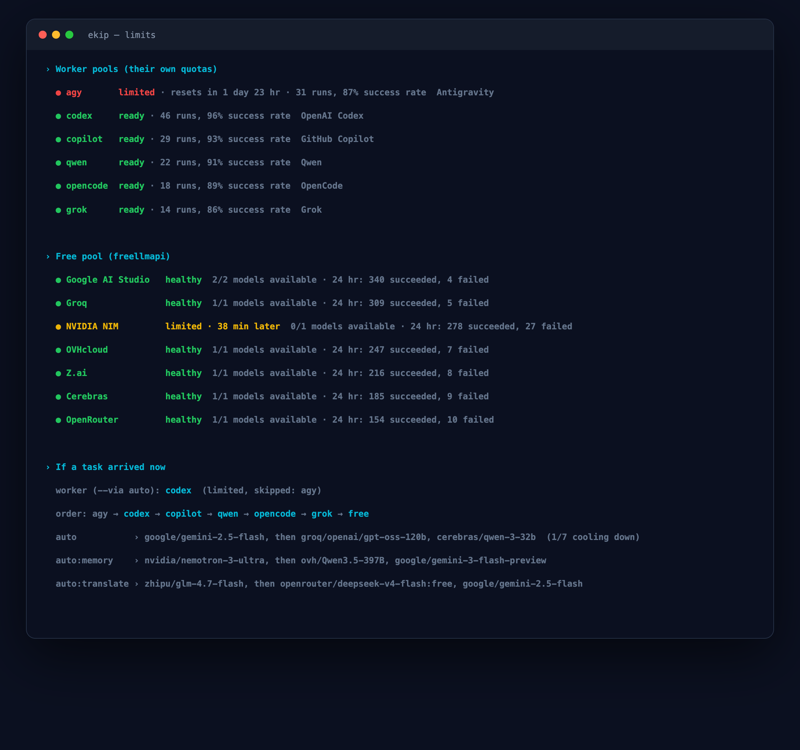

<h1> Commands and pools</h1>

Use the CLI reference below to launch the lead, manage workers and projects, and control the optional hub.

[README](../README.md) · [How it works](architecture.md) · [Memory](memory.md) · [Install](install.md) · **Commands** · [Operations](operations.md)

## CLI help

The command groups below match `EKIP_LANG=en node plugin/bin/ekip.js help`. Options are included where they materially change behavior.

```text
Everyday
  ekip
  ekip --free
  ekip --safe
  ekip status [--system|--json|--offline]   (ekip durum) what runs, waits for you, is stuck, finished; release
  ekip limits
  ekip doctor [--fix]
  ekip update                     bring in the newest release (shows what changed)
  ekip version                    this install's version and the newest release
  ekip show [--pid PID] <log...>  open a live pane on any log (--pid: the job survives its worker)
  ekip track [--task ID] [--step N] --label "what" [--total N] [--measure "CMD"] [--stall MIN] [--eta-max MIN] [--show] [--wait] -- <command...>
  ekip track ls [--all] | stop ID
  ekip project config NAME        create the project's shared .ekip/ folder (rules, review profile, checks)
  ekip terminal install [--dry-run]|open|status  optional: ekip's own terminal (WezTerm, colours, fast panes)

Workers
  ekip run [--via POOL|a,b,c] [--project NAME] [--model ID] [--plugin P] [--skill S] [--worktree] "task"
  ekip run [--after ID | --when "CMD"] [--resume RUN] [--min-tier strong] [--heavy|--light] [--retry-on-kill]
  ekip review [--project NAME] [--base REF] [--checks-only] [--via a,b] [--dry-run]
  ekip review profile NAME [--refresh]
  ekip clean <id>
  ekip mesai on [--include-claude]|off|status|all "task"
  ekip agents ls|install|login|test
  ekip team up|down|ls|open [--open]

Development environment
  ekip dev init --postgres <uuid> [--superuser NAME] [--secrets FILE] [--redis <uuid>]
  ekip dev ls|add|up|env|down|reset|sql|psql

Projects and memory
  ekip project add|remove|move|scan|ls|show|sync|card
  ekip project lesson NAME|genel "lesson"   a corrected mistake, added to every worker brief (genel: the lead's own)
  ekip memory search|remember|ingest|import-history|reindex|up|down|status|open
  ekip skill ls|search|show|learn|prune|candidates|accept|reject
  ekip stats [project] [--days N] [--json]   how memory, wiki, skills and code graph are used
  ekip tasks [--watch|--all]
  ekip task new|step|add|note|done|fail|cancel
  ekip task done ID "result" [--link PATH|URL]...  |  task result ID "result" [--link L]...
  ekip task ask ID "question" [--option A]... | answer ID "choice"
  ekip task block|wait ID "why" | unblock ID
  ekip tasks sync

VPS hub
  ekip job "task" --project NAME [--via auto|copilot|free] | ls | show ID
  ekip hub link|push|status|open
  ekip remote <ssh-host>
  ekip tunnel install|status
  ekip vps add|token|status|sh|apps|deploy|logs|restart

Setup
  ekip init
  ekip keys [--all|apply]
  ekip key add|list
  ekip up|down|logs
```

On first lead start, ekip greets you and suggests missing setup steps. `ekip doctor` lists the same gaps under Kurulum.

### Worker runs and review

`ekip run` sends a worker brief; use `-` to read it from standard input. `--via auto` chooses among tested, eligible pools. A comma-separated list such as `--via agy,codex` races workers in separate Git worktrees and branches. `--worktree` gives one worker its own worktree. Child runs are capped; `--allow-nested` is an internal override for bounded nested work, not a general way to remove the cap.

Options that keep work moving without you:

- `--after ID` starts the run once task `ID` (from `ekip task new`) is done or run `ID` (its log name in `data/runs`) exited 0; `--when "CMD"` starts it once the shell command exits 0. Both are checked every 30 seconds for up to `waitMaxH` hours (default 24) in a background process, so the run starts even after the lead's turn ended; its report goes to `data/queued/`. The task shows the step as blocked ("waiting for a condition") meanwhile. `--foreground` waits in the calling process instead. A failed dependency blocks the task and does not start the run.
- `--resume RUN` runs the brief of run `RUN` again, with the same task link and label, prefixed with a note to look at the half-finished changes and continue rather than start over.
- `--min-tier strong` never falls back to a weak pool (pools on the free-tier models; strong ones are agy, codex, gemini, copilot and claude, `strongPools` in `data/config.json`); `--no-fallback-free` only keeps the free pool out. A pool named with `--via` always runs.
- `--heavy` takes one of the machine's heavy slots before starting (default count from cores and memory, e.g. 3 on 8 cores and 16 GB; `maxLocalWorkers`), `--light` never does; without either, a brief that mentions a render, encode or similar is heavy. With no free slot, or a 1-minute load above 3x the cores (`maxLoadPerCore`), the run waits in line and the task shows "queued (place n)".
- `--retry-on-kill` restarts a worker that was killed by a signal (137, 143) once, after the load has come down; the cause ekip guessed (load, memory pressure, an outside signal) is noted on the task either way.

Every fallback from one pool to the next is noted on the task with its reason, including the quota reset time when the CLI gave one. After a pool was stopped for silence, the weak pools left in the order are skipped; a second silent pool in a row stops the chain, blocks the task and sends a notification. A quota message's reset time (`Resets in …`, `try again at …`, `try again in …`) is written to the pool's state in `data/config.json`; `ekip agents` shows "limited until …" and `auto` skips the pool until then or until a later run on it succeeds.

Every pool takes a limited number of workers at once (`poolConcurrency` in `data/config.json`; defaults agy, codex and copilot 2, qwen, opencode and grok 1, free 3, claude 0). A running worker is a run log without an `[exit]` line whose `ekip run` process is alive; `--via auto` skips pools at capacity (the free pool stays as the last fallback). `ekip mesai on` (work shift) adds a section to new lead sessions telling the lead to split requests into parallel parts over every free slot; `--include-claude` gives the headless Claude pool capacity 1. `ekip mesai status` prints each pool's state, running/capacity and success rate; `ekip mesai all "task"` races the task on every ready pool with a free slot, like `--via a,b,c`. `ekip status`, `ekip limits`, the task pane header and the panel's Pools page show running/capacity too.

`ekip review` reviews the current changes with project profile lenses and configured checks. `--dry-run` prints the plan without running checks or reviewers; `--checks-only` skips reviewer runs. `--via` selects review pools. `ekip review profile NAME [--refresh]` creates or refreshes a registered project's profile. Review check commands pass through a safety filter.

### Tasks and liveness

`ekip tasks` lists live tasks; `--watch` follows updates and `--all` includes closed tasks. The lead creates and updates tasks with `ekip task new`, `step`, `add`, `note`, `done`, `fail`, and `cancel`. A step can be marked `running`, `done`, `failed`, or `skipped`; `--pct`, `--note`, `--detail`, `--parallel`, and `--alive` provide progress context. `--alive` refreshes liveness during a long step. `ekip tasks sync` resends task state to the hub if the panel is stale. `ekip reconcile` closes runs whose processes disappeared without reporting.

`ekip task done ID "one-sentence result" --link out/final.mp4 --link https://…` closes the task with its result: the sentence and up to five links (paths and URLs found in the sentence are added) are kept as the task's `result` and shown as "Sonuç: …" in the pane, in `ekip status` and on the panel (URLs open, file paths are copied). When `ekip run --task ID` ends well, the first meaningful paragraph of the worker's report (at most 300 characters, headings, code and tables skipped) and up to three file paths or URLs from it become the task's result and a note, until the lead writes its own; `ekip task result ID "…" [--link …]` corrects it without closing the task. A result the lead wrote is never replaced by a worker report.

`ekip task ask ID "Shall we render the character again?" --option "Yes" --option "No"` puts a decision on the task: the step waits for the user (`waiting-user`, with a notification) and the question with its options sits at the top of the panel ("Senden beklenenler") and of `ekip status` until `ekip task answer ID "Yes"`, which notes the decision and lets the step run again. The lead calls it whenever it asks the user something in chat, so a question asked once does not get lost in the conversation.

`ekip status` (or `ekip durum`) is one screen in plain words with five parts: what runs now (each task's running step, percent, speed and estimated finish, its workers and tracked jobs with their last output line, plus workers and tracked jobs without a task), what waits for you (questions and options), what is stuck and why (blocked, paused with no live process, no progress for 15 minutes, or failed in the last 24 hours) with what ekip did about it (pool switches, restarts, stopped workers), what finished in the last 24 hours with its result and links, and ekip's release state: this install's version, main's last commit and whether the hub's CI is testing it (with how long), passed or failed it, and whether the hub runs that commit. The release part comes from the hub's `GET /api/release`; without a hub, main's head comes from `git ls-remote`. `--offline` skips the network and shows the last release state seen, `--json` prints it all, `--system` shows the older view of pools, memory, panel and recent runs. The task pane shows the counts (waiting for you, stuck, running, finished), the first question, the first stuck job and the release line on top.

`ekip task block ID "reason"` marks the running (or next) step `blocked`, `ekip task wait ID "what the user decides"` marks it `waiting-user` and sends a notification; `--step N` picks the step. Neither shows a stall warning or an estimate, and a held task waits up to 72 hours instead of 6 before it is closed. `ekip task unblock ID` (or marking the step running) ends the hold. `ekip task cancel` and `done` also stop the task's live workers (SIGTERM to their `ekip run`). Every task command, the pane and the hub sync close workers whose process is gone, with the reason from their log; a task with a running step and no live worker for 5 minutes shows as "paused: no live worker" (10 minutes when the task never had a worker). Such an orphaned task is noted once on the task and comes first in the lead's next prompt as a mandatory action (close it or restart it under a live process).

`ekip track` runs a long shell command as a watched job: `ekip track --task ID --step N --label "upload" --total 1.5G --stall 10 --eta-max 60 -- aws s3 cp big.mp4 s3://bucket/`. One argument after `--` is a shell line; several are quoted word by word. The command runs detached in its own process group with its output in `data/runs/<id>-track.log` (the task pane lists it like a worker; `--show` opens a pane on the log, `--wait` stays until it ends and exits with its code). Without `--step` it takes the running step, else the next pending one, else a new step named after the label. Every 30 seconds (`EKIP_TRACK_TICK_S`) it measures progress: a byte pair, a count (`3/12`, `[ 45/120]`), a percent or a byte count in the output, or the first number `--measure "CMD"` prints (a size like `1.2G` counts as bytes) against `--total` (bytes such as `1.5G`, or a count). The step gets the percent, the speed and the finish time in its detail line. With nothing to measure, new output counts as progress. No progress for `--stall` minutes (default 10) blocks the step with the last output line and sends a notification; progress back unblocks it. With `--eta-max MIN`, the speed of the first two minutes (`EKIP_TRACK_PROBE_S`) is checked once: a finish past the limit, or no measurable speed, is noted on the task with a notification. Exit 0 closes the step done; any other exit closes it failed with the last five output lines on the task, and a signal gets the likely cause (load, memory pressure, an outside signal). `ekip track ls` lists running and recent jobs (state in `data/tracks/`); `ekip track stop ID` (any unique part of the id) stops only that job's own process group. A cancelled task stops its tracked jobs too.

### Terminal

`ekip terminal install` installs WezTerm with `brew install --cask wezterm` (or prints how, without Homebrew or off macOS) and writes `~/.config/wezterm/ekip.lua` (`$XDG_CONFIG_HOME` is honoured): the dark brand theme, a 14 pt font, the open tasks in the tab bar and the status line, and keys on Cmd+Alt (Ctrl+Alt off macOS): `T` task pane under the lead (focuses it when it is open), `D` a pane in the right-hand column, `S` one more under it, `E` a new ekip lead in a tab, `Z` zoom, arrows move between panes. Without a `wezterm.lua` it writes a small one that loads `ekip.lua`; an existing one is never changed, and the command prints the two lines to add. `--dry-run` only prints what it would do. `ekip terminal open` starts the lead in WezTerm in the current folder; `ekip terminal status` shows the detected terminal and the config state; `ekip terminal config` prints `ekip.lua`. The doctor and the lead start suggest it once to iTerm2 users, and to Terminal.app users as the way to get a task pane.

States in the task pane, `ekip tasks` and `ekip agents` share one table (`plugin/lib/core/status-style.js`): running teal ●, done green ✓, failed red ✗, blocked orange ■ with the reason, waiting for the user yellow ? (listed first), paused or orphaned grey ◌ ("no process is working on it"), queued blue ⧗ with the place. Progress bars take the task's colour and get shorter in narrow panes. Without 256 colours or truecolor the symbols turn into ASCII (`* + x # ? o ~`), also with `EKIP_ASCII=1`; `NO_COLOR`, a pipe or `TERM=dumb` drop the colour.

### Development databases

`ekip dev init --postgres UUID [--superuser NAME] [--secrets FILE] [--redis UUID]` configures shared development resources. Per-project operations are `ls`, `add`, `up`, `env`, `down`, `reset`, `sql`, and `psql`. `up` creates a project `.env.ekip-dev` and opens a tunnel. `reset` requires `--yes`. Production database targets are refused.

### Skills and projects

`ekip skill learn [PROJECT|--all] [--dry-run]` proposes reusable project procedures. `candidates` lists them; `accept PROJECT NAME` and `reject PROJECT NAME` record an explicit decision. `prune [PROJECT|--all] [--apply]` checks stale generated skills. `ls`, `search`, and `show` inspect skills.

`ekip project add PATH`, `remove NAME`, and `move NAME OLD_PATH NEW_PATH [--dry-run]` manage registration. `scan`, `ls`, `show`, `sync`, and `card` discover or inspect projects and refresh their context.


## Worker pools

| Pool | Worker | Quota or route |
|---|---|---|
| `auto` | First eligible worker in the learned order, then `free` | Tested and available workers; limited pools are skipped |
| `agy` | Antigravity | Google account quota |
| `codex` | OpenAI Codex CLI | ChatGPT plan |
| `gemini` | Gemini CLI | `GEMINI_API_KEY`; hidden unless configured |
| `copilot` | GitHub Copilot CLI | Copilot free tier or plan |
| `qwen` | Qwen Code | Qwen OAuth, or freellmapi until signed in |
| `opencode` | OpenCode | Its free models or configured providers |
| `grok` | grok-cli | freellmapi, or xAI with `GROK_API_KEY` |
| `free` | Free-pool route | freellmapi free-tier models |
| `claude` | Headless Claude | Claude subscription; reserve for work that needs it |

`auto` is based on configured order, recent pool success rates, and a 15-minute cooldown after failures. `ekip limits` shows the next worker, quota resets, provider availability, and model routes.



## Development databases

Run `ekip dev init --postgres <uuid> [--superuser NAME] [--secrets FILE] [--redis <uuid>]` once to record the shared development Postgres container. These values stay in `data/config.json`. Use `ekip dev add PROJECT [--db NAME]` to map a project to an isolated `_dev` database; `ekip dev up [PROJECT]` opens the local SSH tunnel and writes `.env.ekip-dev` at the registered project root. Workers should source that file and never use production URLs from project `.env` files for tests or migrations. Use `ekip dev reset PROJECT --yes` for a development reset and `ekip dev down` when finished. `ekip dev env PROJECT --shell` prints shell exports; passwords are masked by default. For quick queries, run `ekip dev sql PROJECT "..."`.

Hub jobs currently run in the VPS worker without the Mac settings bridge. To supply dev credentials there, persist the dev project map and Redis/Postgres UUIDs in hub configuration, then call `devEnv(PROJECT, { onVps: true })` before spawning the worker so URLs use the Coolify container IPs directly. Do not pass production resource UUIDs or URLs.

## Shared tools

ekip's own services live outside project repositories: freellmapi (free pool), TencentDB Agent Memory (memory) and hoptell (team peers). `ekip init` clones each one once; their locations are stored in `data/config.json` (`freellmapiDir`, `tdaiDir`, `hoptellDir`), and every project uses the same installation.

---

[← Back to README](../README.md) · Next: [Operations](operations.md)
