<h1> Install</h1>

Set up ekip on macOS, configure free-provider keys, and optionally connect an always-on VPS hub.

[README](../README.md) · [How it works](architecture.md) · [Memory](memory.md) · **Install** · [Commands](commands.md) · [Operations](operations.md)

## Requirements

- macOS with Git, tmux, SQLite, and Node.js 22 or later. freellmapi supports Node 22 to 24.
- Docker Desktop or OrbStack for local memory and model services, unless you use a VPS hub.
- [Claude Code](https://claude.com/claude-code), installed and signed in.
- Optional worker CLIs: Antigravity, Codex, Copilot, Qwen Code, OpenCode, and grok-cli. `ekip init` installs supported npm CLIs.

## Install on your Mac

```bash
git clone https://github.com/duzgunberke/ekip.git
cd ekip
node plugin/bin/ekip.js init
```

`init` is interactive and safe to rerun. It links the `ekip` command, starts freellmapi and hoptell, launches the local TencentDB memory services, installs the Claude Code plugin with its skills and hooks, registers ekip and codegraph MCP servers, installs worker CLIs, opens the provider-key wizard, starts agent sign-in, and registers projects with commits from the last 30 days.

```mermaid
%%{init: {'theme':'base','themeVariables':{'primaryColor':'#10302B','primaryTextColor':'#ECEEF2','primaryBorderColor':'#2DD4BF','lineColor':'#5EEAD4','secondaryColor':'#24180F','tertiaryColor':'#15181E','fontFamily':'Inter, -apple-system, Segoe UI, sans-serif'}}}%%
flowchart LR
  init["ekip init"] --> services["Start local services"]
  services --> plugin["Install plugin, hooks, and MCP servers"]
  plugin --> workers["Install worker CLIs and sign in"]
  workers --> keys["Configure provider keys"]
  keys --> projects["Register recent projects"]
  projects --> ready["Open a new terminal and run ekip"]
  classDef amber fill:#24180F,stroke:#F08A3C,color:#ECEEF2;
  classDef teal fill:#10302B,stroke:#2DD4BF,color:#ECEEF2;
  class init,services,plugin,workers,keys,projects,ready teal;
```




## Optional: ekip's own terminal

ekip works in iTerm2 (recommended so far) and opens panes there with AppleScript. For a faster,
more colourful setup, let ekip install WezTerm and its config:

```bash
ekip terminal install --dry-run   # what it would do
ekip terminal install             # brew install --cask wezterm, then ~/.config/wezterm/ekip.lua
ekip terminal open                # start the lead in WezTerm
```

Your own `~/.wezterm.lua` or `~/.config/wezterm/wezterm.lua` is not changed; if you have one, add the
two lines the command prints before `return config`. Without Homebrew the command prints the install
steps instead. Nothing changes for iTerm2 users who skip this.

## Provider keys

Use the interactive wizard to configure free-tier keys. Enter skips a provider; `q` stops the wizard. `--all` asks again for providers that already have keys, and `apply` restarts freellmapi with the current configuration.

```bash
ekip keys
ekip keys --all
ekip keys apply
```

The wizard's provider list, in order, is Groq, Google AI Studio, Cerebras, OpenRouter, NVIDIA NIM, Mistral, Cloudflare Workers AI, Cohere, Z.ai (Zhipu), HuggingFace, Routeway, BazaarLink, Router9, and ModelScope. The last four provide free DeepSeek routes. Cloudflare keys use `ACCOUNT_ID:API_TOKEN`.

## Optional VPS hub

The hub keeps the web panel, job queue, memory, and free model pool available while your Mac is off. Follow [hub/README.md](../hub/README.md) for deployment prerequisites and Docker Compose configuration; use a placeholder domain such as `ai.example.com`.

1. Deploy the hub and freellmapi, then point the TencentDB memory services at freellmapi as described in the hub guide.
2. Mount patched TencentDB files into the memory container. The startup script mounts files under `tdai-patches/app/`; see [the patch deployment notes](../hub/tools/tdai-patches/README.md).
3. Route the example domain to the hub service. Keep memory and freellmapi ports private.
4. On the Mac, set the remote SSH host, install the launchd tunnel, link the hub, and push project metadata:

```bash
ekip remote <ssh-host>
ekip tunnel install
ekip hub link https://ai.example.com <EKIP_HUB_TOKEN>
ekip hub push
ekip memory import-history
```

## Language

The CLI supports English and Turkish. Set `EKIP_LANG=en` or `EKIP_LANG=tr`; otherwise `data/config.json`'s `lang` value is used, followed by the system locale.


---

[← Back to README](../README.md) · Next: [Commands](commands.md)
