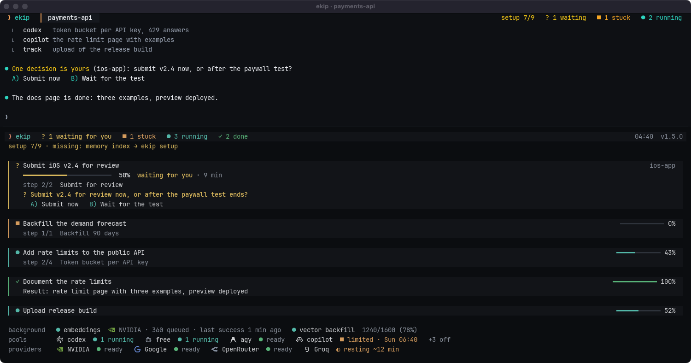
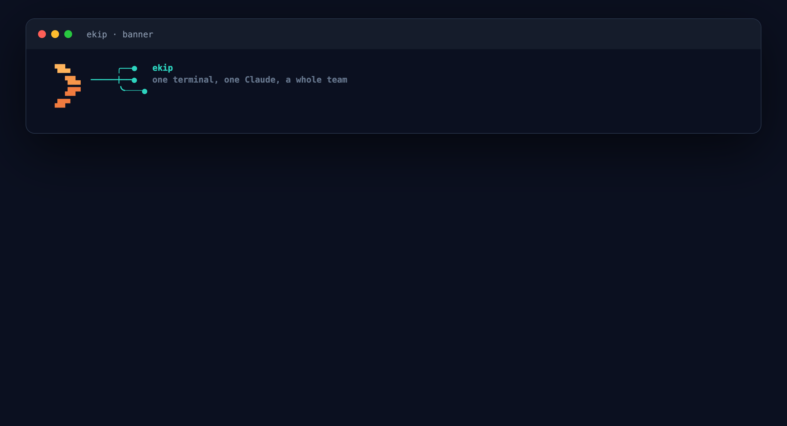
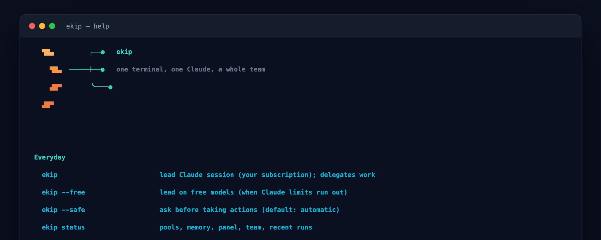

<h1> Install</h1>

Set up ekip on macOS, configure free-provider keys, and optionally connect an always-on VPS hub.

[README](../README.md) · [How it works](architecture.md) · [Memory](memory.md) · **Install** · [Commands](commands.md) · [Operations](operations.md)

## Requirements

- macOS with Git, tmux, SQLite, and Node.js 22 or later. freellmapi supports Node 22 to 24.
- Docker Desktop or OrbStack for local memory and model services, unless you use a VPS hub.
- [Claude Code](https://claude.com/claude-code), installed and signed in.
- Optional worker CLIs: Antigravity, Codex, Copilot, Qwen Code, OpenCode, and grok-cli. `ekip init` installs supported npm CLIs.

## Install on your Mac

```bash
git clone https://github.com/duzgunberke/ekip.git
cd ekip
node plugin/bin/ekip.js init
```

`init` is safe to rerun. It first asks the language (Turkish or English, the system's by default), then links the `ekip` command, starts freellmapi and hoptell, launches the local TencentDB memory services, installs the Claude Code plugin with its skills and hooks, registers ekip and codegraph MCP servers, installs worker CLIs, starts the web panel and offers ekip's own terminal. At its end it hands over to the guided setup (`ekip setup`), which walks what is still missing.

```mermaid
%%{init: {'theme':'base','themeVariables':{'primaryColor':'#10302B','primaryTextColor':'#ECEEF2','primaryBorderColor':'#2DD4BF','lineColor':'#5EEAD4','secondaryColor':'#24180F','tertiaryColor':'#15181E','fontFamily':'Inter, -apple-system, Segoe UI, sans-serif'}}}%%
flowchart LR
  init["ekip init"] --> services["Start local services"]
  services --> plugin["Install plugin, hooks, and MCP servers"]
  plugin --> workers["Install worker CLIs"]
  workers --> setup["ekip setup: keys, embeddings, logins, projects, index, terminal"]
  setup --> ready["Open a new terminal and run ekip"]
  classDef amber fill:#24180F,stroke:#F08A3C,color:#ECEEF2;
  classDef teal fill:#10302B,stroke:#2DD4BF,color:#ECEEF2;
  class init,services,plugin,workers,setup,ready teal;
```



## Guided setup

`ekip setup` (or `ekip kurulum`) is one list of everything a working ekip needs, checked in about a second and cached for ten minutes (`data/setup-state.json`):

| Step | Level | Done when | Command |
|---|---|---|---|
| Prerequisites | required | Node 22+, git, Claude Code, Docker running (not needed with a VPS hub), a git identity | `brew install node git && open -a Docker` |
| ekip services | required | `ekip` on the PATH, freellmapi and the memory service answer | `ekip init`, `ekip up`, `ekip memory up` |
| Free model keys | required | at least one provider key | `ekip keys` |
| Embedding provider | required | an NVIDIA or OpenRouter key, or `MEMORY_EMBEDDING_BASE_URL` | `ekip key add nvidia <key>` |
| Worker CLI logins | required | two pools ready (signed-in CLIs, plus the free pool when it has keys) | `ekip agents login` |
| A project | required | at least one registered project | `ekip project add <folder>` / `ekip project scan <parent>` |
| Project index | required | every project has its card, code graphs and wiki, its Claude history is imported, no records lack vectors | `ekip project sync <project>`, `ekip memory catch-up`, `ekip memory reindex` |
| ekip's terminal | recommended (macOS) | WezTerm installed and the default | `ekip terminal install` |
| Notifications | recommended (macOS) | `terminal-notifier` installed | `brew install terminal-notifier` |
| Hub | optional | a hub is linked | `ekip hub local` or `ekip hub link <url> <token>` |

In a terminal it shows `Setup 5/9` with a bar, and for each missing step why it matters and the command, then asks **now / later / skip**. "Now" runs what needs you right there: `ekip keys` opens each provider's key page, the embedding step opens NVIDIA's key page and adds the key you paste, `ekip agents login` signs in to the worker CLIs, the project step asks for a folder. Indexing and the history import start in the background under `ekip track`. Each step is checked again when it finishes. "Skip" silences the step until `ekip setup unsnooze <id>`. Without a terminal (or with `--list`) it prints the list; `--json` gives the counts and steps to scripts.

Without an embedding provider, memory and wiki search fall back to keywords and miss records that match in meaning. ekip embeds with `nemotron-3-embed-1b` through the free pool, which NVIDIA and OpenRouter both serve for free (a limit on one falls back to the other with identical vectors). Any OpenAI-compatible endpoint works too, through `MEMORY_EMBEDDING_BASE_URL` and `MEMORY_EMBEDDING_MODEL`; no separate vector database is needed.

ekip reminds you without getting in the way:

- **Task pane:** while a required step is missing, one amber line under the header: `setup 5/9 · missing: model keys, memory index → ekip setup`. It drops names from the end (`+2`) when the pane is narrow and never cuts a word. Recommended steps appear only in `ekip setup` and `ekip status`.
- **WezTerm:** a small `setup 5/9` counter on the right of the tab bar, the first thing to drop when space runs out.
- **Lead start:** the session-start hook offers the single most useful missing step once; if you decline, it is not offered again in that session.
- **Other terminals:** started in iTerm2, Terminal.app or VS Code while WezTerm is not the default, the lead suggests `ekip terminal install` once per start. `ekip setup snooze terminal` silences it for seven days (`ekip setup snooze <id> <days>` for any step).
- **`ekip status`:** a Setup section at the bottom lists what is missing with its command.

The hub panel's overview shows the same checklist (sent with the Mac's limits snapshot), with the hub's own gaps under it: the CI folder (`EKIP_CI_DIR`), the commit it was built from (`EKIP_HUB_COMMIT`), its free pool and memory.





## Optional: ekip's own terminal

ekip works in iTerm2 and opens panes there with AppleScript. For a faster, more colourful setup,
ekip installs WezTerm and its config. On macOS `ekip init` asks once ("Install ekip's own terminal
(WezTerm)? [Y/n]", default yes; `--yes` installs without asking, `--no-terminal` skips, a
non-interactive run never asks). It runs the same steps as:

```bash
ekip terminal install --dry-run   # what it would do
ekip terminal install             # brew install --cask wezterm, ~/.config/wezterm/ekip.lua, ~/Applications/ekip.app
ekip terminal open                # start the lead in WezTerm
```

On macOS the install also builds `~/Applications/ekip.app`: WezTerm under ekip's name and logo, so
the Dock shows one ekip icon instead of WezTerm's. It is an APFS clone of `/Applications/WezTerm.app`
(almost no extra disk until files change) with its own `Info.plist` (`io.ekip.terminal`) and icon,
signed ad hoc and registered with LaunchServices. A small app that only starts WezTerm's binary would
still show WezTerm's icon, because macOS takes the icon from the bundle the running program lives
in. After `brew upgrade --cask wezterm` the copy is out of date: `ekip terminal status` and
`ekip doctor` say so, and `ekip update` or `ekip terminal install` builds it again. ekip's
notifications use the same app, so they carry the logo too.

Both save `"terminal": "wezterm"` in `data/config.json`. From then on `ekip` typed in iTerm2 or
Terminal.app starts the lead in a new WezTerm window (same folder, ekip's variables), waits up to
10 seconds for its pane to show up in `wezterm cli list`, then closes only the session or tab it was
typed in. When WezTerm is already running the window opens in it (`wezterm cli spawn`) instead of a
second WezTerm process, so the Dock keeps one icon. Other terminals are not closed. If the window does not appear, nothing is closed and the
lead starts in the current terminal with the reason. `ekip --here` or `EKIP_TERMINAL=current` stays
put for one start; `ekip terminal default current` turns it off, `ekip terminal default wezterm` back
on; `ekip terminal status` shows the setting. Subcommands, worker panes and hooks never switch.

Your own `~/.wezterm.lua` or `~/.config/wezterm/wezterm.lua` is not changed; if you have one, add the
two lines the command prints before `return config`. Without Homebrew the command prints the install
steps instead. Nothing changes for iTerm2 users who skip this.

## Provider keys

Use the interactive wizard to configure free-tier keys. Enter skips a provider; `q` stops the wizard. `--all` asks again for providers that already have keys, and `apply` restarts freellmapi with the current configuration.

```bash
ekip keys
ekip keys --all
ekip keys apply
```

The wizard's provider list, in order, is Groq, Google AI Studio, Cerebras, OpenRouter, NVIDIA NIM, Mistral, Cloudflare Workers AI, Cohere, Z.ai (Zhipu), HuggingFace, Routeway, BazaarLink, Router9, and ModelScope. The last four provide free DeepSeek routes. Cloudflare keys use `ACCOUNT_ID:API_TOKEN`.

## Optional VPS hub

The hub keeps the web panel, job queue, memory, and free model pool available while your Mac is off. Follow [hub/README.md](../hub/README.md) for deployment prerequisites and Docker Compose configuration; use a placeholder domain such as `ai.example.com`.

1. Deploy the hub and freellmapi, then point the TencentDB memory services at freellmapi as described in the hub guide.
2. Mount patched TencentDB files into the memory container. The startup script mounts files under `tdai-patches/app/`; see [the patch deployment notes](../hub/tools/tdai-patches/README.md).
3. Route the example domain to the hub service. Keep memory and freellmapi ports private.
4. On the Mac, set the remote SSH host, install the launchd tunnel, link the hub, and push project metadata:

```bash
ekip remote <ssh-host>
ekip tunnel install
ekip hub link https://ai.example.com <EKIP_HUB_TOKEN>
ekip hub push
ekip memory import-history
```

## Language

ekip speaks English and Turkish. `ekip init` and `ekip setup` ask once (the system's language by default); `ekip lang` (or `ekip dil`) shows the setting and `ekip lang en` / `ekip lang tr` changes it in `data/config.json`. `EKIP_LANG=en` or `EKIP_LANG=tr` overrides it for one shell.

The setting reaches every part: CLI texts, the task pane and WezTerm labels, hook output, the lead's system text (task titles, steps and notes on the panel are written in your language, with examples in it) and worker reports. The lead always answers in the language you write in. The web panel uses the Mac's setting as its default until you pick a language in the panel.



---

[← Back to README](../README.md) · Next: [Commands](commands.md)
