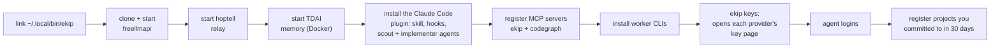

# Install


Mac setup, free model keys and the optional VPS hub.


[← back to the README](../README.md)


## Install

### What you need

- macOS with `git`, `tmux`, `sqlite3` and Node.js 22 or later (freellmapi wants 22 to 24: `brew install node@24`)
- Docker (Docker Desktop or OrbStack) for a local memory stack, or a VPS for the hub
- [Claude Code](https://claude.com/claude-code), logged in
- Optional worker CLIs: Antigravity (`agy`, the strongest), Codex, Copilot CLI, Qwen Code, OpenCode, grok-cli; `ekip init` installs the ones on npm

### On your Mac

```bash
git clone https://github.com/duzgunberke/ekip.git && cd ekip
node plugin/bin/ekip.js init
```

`init` is interactive and safe to run again:



Then open a new terminal and run `ekip`. Ask for anything.

### Free model keys

```bash
ekip keys          # opens each missing provider's key page in turn; paste the key, Enter skips
ekip keys --all    # ask again for providers that already have a key (to replace it)
```

The wizard covers Groq, Google AI Studio, Cerebras, OpenRouter, NVIDIA NIM, Mistral, Cloudflare Workers
AI, Cohere, Zhipu, HuggingFace, and the free DeepSeek routes (Routeway, BazaarLink, Router9,
ModelScope). Keys go into freellmapi's declarative config and, with a hub, straight to the VPS.

### The VPS hub (recommended)

The hub runs what should never sleep. On the server:

1. Copy `hub/` to `/data/ekip/hub`, fill in `hub/.env` from `hub/.env.example`
   (`EKIP_HUB_TOKEN`, `EKIP_HUB_PASSWORD`, `FREELLMAPI_ENCRYPTION_KEY`, …) and run
   `docker compose -p ekip up -d --build`.
2. Clone TencentDB Agent Memory to `/data/ekip/tdai` and start its scripts (`deploy/global-images`)
   with the memory LLM pointed at freellmapi (`MEMORY_LLM_BASE_URL=http://freellmapi:3001/v1`,
   `MEMORY_LLM_MODEL=auto:memory`, `MEMORY_EMBEDDING_MODEL=nemotron-3-embed-1b`).
3. Put the patched files under `/data/ekip/tdai-patches/app/…`; `start-memory-core.sh` bind-mounts
   every file there over the same path in the container ([details](../hub/tools/tdai-patches/README.md)).
4. Route your domain to `http://ekip-hub:7777` (with Coolify: a Traefik dynamic file, see
   [hub/README.md](../hub/README.md)). Keep the TDAI and freellmapi ports closed to the internet.

On the Mac:

```bash
ekip remote <ssh-host>                          # stop local services, use the hub
ekip tunnel install                             # launchd keeps the SSH tunnel up
ekip hub link https://ai.example.com <EKIP_HUB_TOKEN>
ekip hub push                                   # projects, cards and memory ids to the hub
ekip memory import-history                      # past Claude Code sessions into each project's memory
```

---
