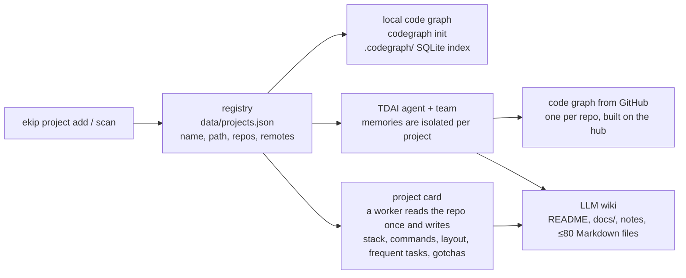
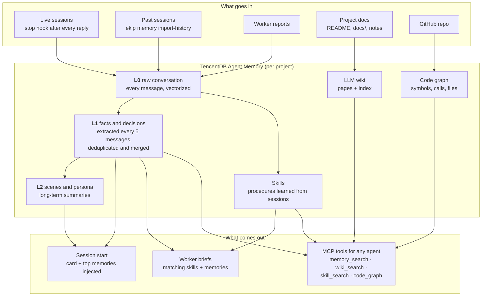

# Memory: vectors, wiki, code graph, skills

How a project gets indexed and what each memory layer does.

[← back to the README](../README.md)

## How a project gets indexed

`ekip project scan` finds every git repo you committed to in the last 30 days; `ekip project add
<path>` adds one by hand (a folder with several repos inside is one project with sub-repos). Each
project then goes through the same pipeline, four parts running side by side:

| Part | What it is | Who uses it |
|---|---|---|
| **Card** (`data/projects/<name>.md`) | one page: what the project is, stack, build/test/deploy commands, folder layout, frequent tasks, gotchas; written once by a worker that reads the repo | injected at session start in that project; put in every worker brief |
| **Local code graph** ([codegraph](https://github.com/colbymchenry/codegraph)) | a SQLite index of every symbol, file and call edge in the repo (30+ languages), kept in `.codegraph/` and hidden from git | the `codegraph` MCP server: one `codegraph_explore` call returns the exact source of the symbols a question touches, plus the call paths between them, instead of a grep-and-read loop |
| **Code graph from GitHub** | the same idea built by TDAI on the hub from the remote repo | agents that run on the hub, the panel's code map |
| **LLM wiki** | pages written by an LLM from the project's docs, linked to each other | `wiki_search` / `wiki_read` MCP tools, worker briefs |
| **Memory and skills** | see the next section | session start, worker briefs, `memory_search` / `skill_search` |

`ekip project sync <name>` refreshes all of it after big changes; `ekip doctor` shows each project's
graphs, wiki and memory, and `--fix` re-queues what failed.

**Why a code graph saves tokens.** Without one, an agent answering "how does the paywall decide who
is premium?" greps, opens five files, reads them whole, and greps again. With one, it asks the graph
for the symbols involved and gets back only their source and how they call each other: the same
answer for a fraction of the tokens, and in one round trip.

## The memory: vectors, wiki, graph, skills

Memory is [TencentDB Agent Memory](https://github.com/TencentCloud/TencentDB-Agent-Memory) (TDAI),
self-hosted on the hub, with every LLM call going to the free pool. Each registered project gets its
own agent inside it, so memories never leak between projects.

| Layer | What it holds | How it is searched |
|---|---|---|
| **L0** | every user and assistant message | vector (semantic) + BM25 (keywords), merged |
| **L1** | facts, decisions, preferences, recurring fixes | vector + BM25 |
| **L2** | scene files and a persona per project | read whole |
| **Skills** | "how this project builds, releases, fixes X", with a name and description | BM25 routing, then the body |
| **Wiki** | pages written from the project's docs, with links between them | full text + graph |
| **Code graph** | symbols and call edges from the repo | `code_graph` tool, or `codegraph` locally |

**What is stored, and what is deliberately not.** The conversation is stored: your messages, the
lead's replies, worker reports, and the facts extracted from them. Tool traffic is not: file dumps,
command output and logs are most of a coding session's bytes and none of its decisions, and storing
them drowned the facts and multiplied the cost (`TDAI_IMPORT_LEAN=1` is the default). Thinking is not
stored either; the conclusion is already in the reply.

**Vectors.** All layers use one pinned embedding model, `nemotron-3-embed-1b` (2048 dimensions,
multilingual), served by NVIDIA with an OpenRouter fallback that returns identical vectors. A Turkish
question finds an English or Chinese memory about the same thing. The model never changes for an
existing index; `ekip memory reindex` backfills records that have no vector, resumably.

**Language.** Memories are written in the language you wrote in. TDAI's prompts are Chinese, and
small free models drift into Chinese because of it, so ekip patches the prompts with one strict
language rule (see [patches](operations.md#patches-to-upstream-projects)) and ships a translator for records that
were already written in the wrong language (`hub/tools/tdai-translate-l1.mjs`).

**Wiki.** Each project's Markdown is sent to TDAI's wiki builder, which extracts candidate pages with
an LLM, merges them into existing pages and indexes the result. Sources the model fails on are retried
by `ekip doctor --fix` once the wiki is ready.

---
