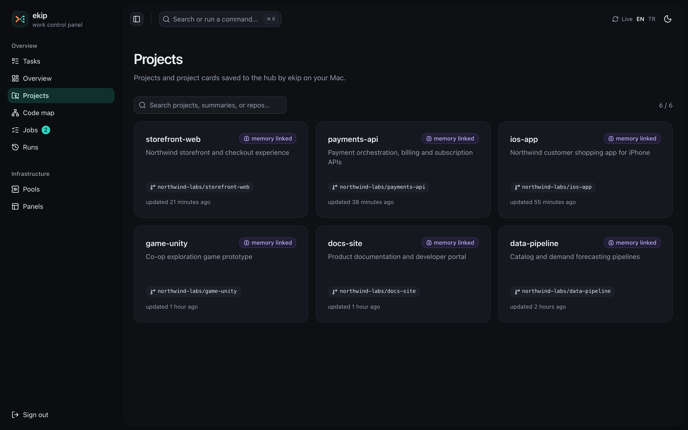

<h1> Memory</h1>

See how ekip indexes projects and uses memory, skills, a wiki, and code graphs to prepare context.

[README](../README.md) · [How it works](architecture.md) · **Memory** · [Install](install.md) · [Commands](commands.md) · [Operations](operations.md)

## Project indexing

`ekip project scan` finds repositories with recent commits; `ekip project add <path>` registers one directly. Registration creates a project card, a local codegraph index, and a per-project TencentDB Agent Memory workspace with a wiki and GitHub code graph.

```mermaid
%%{init: {'theme':'base','themeVariables':{'primaryColor':'#10302B','primaryTextColor':'#ECEEF2','primaryBorderColor':'#2DD4BF','lineColor':'#5EEAD4','secondaryColor':'#24180F','tertiaryColor':'#15181E','fontFamily':'Inter, -apple-system, Segoe UI, sans-serif'}}}%%
flowchart LR
  add["ekip project add / scan"] --> card["Project card"]
  add --> local["Local codegraph index"]
  add --> memory["Per-project memory"]
  memory --> wiki["Wiki from project docs"]
  memory --> graph["GitHub code graph"]
  card --> brief["Session context and worker briefs"]
  local --> cli["Local codegraph MCP"]
  wiki --> mcp["Wiki search and read"]
  graph --> mcp
  memory --> mcp
  classDef amber fill:#24180F,stroke:#F08A3C,color:#ECEEF2;
  classDef teal fill:#10302B,stroke:#2DD4BF,color:#ECEEF2;
  class add,card,local,memory,wiki,graph,brief,cli,mcp teal;
```

| Index | Purpose |
|---|---|
| Project card | Stack, layout, build and test commands, recurring tasks, and gotchas. Injected when a session starts in that project and included in worker briefs. |
| Local codegraph | A local SQLite code index in `.codegraph/`, queried through the codegraph MCP server or CLI for relevant symbols and call paths. |
| GitHub code graph | A TencentDB graph built from each registered GitHub repository. Agents and the panel use it to inspect project structure and symbols. |
| Wiki | Linked pages generated from project documentation and searchable through the wiki MCP tools. |
| Memories and skills | Per-project facts, decisions, and learned procedures, described below. |

Use `ekip project sync <name>` to refresh project indexes. `ekip doctor` reports their status; `ekip doctor --fix` re-queues safe repairs.

## Memory layers and tools

TencentDB Agent Memory runs on the hub or local stack. Each registered project has its own memory agent, keeping project context separate.

```mermaid
%%{init: {'theme':'base','themeVariables':{'primaryColor':'#10302B','primaryTextColor':'#ECEEF2','primaryBorderColor':'#2DD4BF','lineColor':'#5EEAD4','secondaryColor':'#24180F','tertiaryColor':'#15181E','fontFamily':'Inter, -apple-system, Segoe UI, sans-serif'}}}%%
flowchart TB
  conversation["Live conversations, imported history, worker reports"] --> l0["L0: conversation records"]
  l0 --> l1["L1: extracted facts and decisions"]
  l1 --> l2["L2: scenes and project persona"]
  conversation --> skills["Skills: learned procedures"]
  docs["Project documentation"] --> wiki["Wiki: linked reference pages"]
  repo["GitHub repository"] --> graph["Code graph: symbols and calls"]
  l1 --> hook["Prompt and session context"]
  l1 --> tools["Memory search MCP"]
  l2 --> tools
  skills --> tools
  wiki --> tools
  graph --> tools
  classDef amber fill:#24180F,stroke:#F08A3C,color:#ECEEF2;
  classDef teal fill:#10302B,stroke:#2DD4BF,color:#ECEEF2;
  class conversation,l0,l1,l2,skills,docs,wiki,repo,graph,hook,tools teal;
```

| Layer | Contents | Retrieval |
|---|---|---|
| L0 | Conversation messages and worker reports | Semantic vectors and keyword search |
| L1 | Extracted, deduplicated facts and decisions | Semantic and keyword search |
| L2 | Long-term scene summaries and project persona | Read as project context |
| Skills | Procedures learned from project work, such as build, release, and recurring fixes | Search by description, then read the skill |
| Wiki | Pages generated from project documentation | Search and read linked pages |
| Graph | Repository files, symbols, and call relationships | Code graph tools or local codegraph |

## Memory that follows your message

The `UserPromptSubmit` hook looks for registered project names and repository folder names in each message. Matching tolerates common typos; it adds relevant L1 facts, project skills, and the card summary to the prompt. It searches up to two named projects. If no project is named, it uses the registered project containing the current folder. L1 lookup is typically about a second, within a short hook time budget.

## Is the knowledge used?

Every lookup is appended to `data/knowledge-usage.jsonl`: what the prompt hook injected for each message, what went into each worker brief (with the run id), and every MCP tool call (`memory_search`, `wiki_search`, `wiki_read`, `skill_search`, `skill_get`, `code_graph`, `project_card`, `memory_remember`). Queries are redacted and clipped; a worker's MCP calls carry its run id, the lead's carry none. Logging never breaks the call it describes.

`ekip stats [project] [--days N] [--json]` reads it back per project: lookups by kind and source, hit rate (the lookup returned something), the most used skills, whether a worker opened a SKILL.md its brief listed (its run log mentions the file more often than the brief line), and run success for briefs with and without knowledge. These are signals, not proof. `ekip stats` and `ekip doctor` push the summary to the hub (`PUT /api/usage`), where the Projects page and the overview show it.

## Joining a project in flight

`ekip memory import-history` imports past Claude Code sessions into their registered project memories. By default it considers sessions from the last 30 days and up to 200 MB each; imports are incremental. Use `--all` for the full history, or adjust the limits:

```bash
ekip memory import-history
ekip memory import-history --days 90 --max-mb 500
ekip memory import-history --all
```

## What is stored, and what is not

Memory keeps conversation text, worker reports, and facts extracted from them. Lean import is enabled by default: tool output such as file dumps, command output, and logs is not imported. Model reasoning is not stored either; the assistant's reply contains the useful conclusion. Set `TDAI_IMPORT_LEAN=0` only if you explicitly need full tool traffic.

## Vectors and language

The index uses the pinned `nemotron-3-embed-1b` embedding model with 2048 dimensions. NVIDIA serves it, with OpenRouter as a fallback using the same model so existing vectors remain compatible. `ekip memory reindex` resumably fills records without vectors.

Memory text follows the language of the user's message. TencentDB prompts are patched with a strict language rule because their original Chinese instructions could cause smaller models to answer in Chinese or copy the language of older memories. See [the upstream patch notes](operations.md#upstream-patches).

For the background on vector databases, see the author's [2023 article on Medium](https://medium.com/@duzgunberke/vekt%C3%B6rel-database-nedir-ne-i%C5%9Fe-yarar-f832b30421ac).

<table>
  <tr>
    <td width="50%"><br><sub>Registered projects</sub></td>
    <td width="50%"><br><sub>Project code graph</sub></td>
  </tr>
</table>

---

[← Back to README](../README.md) · Next: [Install](install.md)
